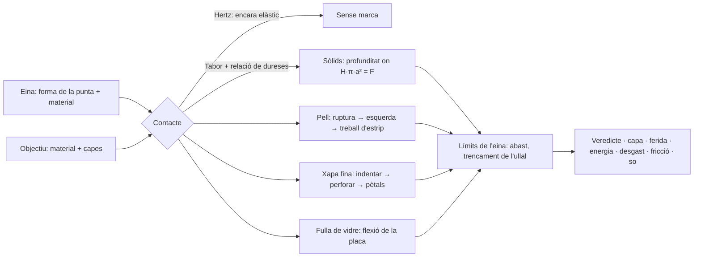

<div align="center">

[English](README.md) · [Español](README.es.md) · **Català**


# Tribology Simulator & Industrial Workshop

**Què ratlla, talla, perfora o trenca què, i per què. I com tallen de debò un torn, una radial i una esmoladora.**

Desenvolupat per [Eric Valls Gramunt](https://github.com/AcidClawX41).

[](https://github.com/AcidClawX41/Scratch-Tribology-Simulator/releases)

[](https://github.com/AcidClawX41/Scratch-Tribology-Simulator/releases)
[](https://github.com/AcidClawX41/Scratch-Tribology-Simulator/releases)
[](https://github.com/AcidClawX41/Scratch-Tribology-Simulator/releases)
[](https://github.com/AcidClawX41/Scratch-Tribology-Simulator/releases)
[](https://github.com/AcidClawX41/Scratch-Tribology-Simulator/releases)

[](https://godotengine.org)
[](LICENSE)
[](#descàrrega)
[](https://github.com/AcidClawX41/Scratch-Tribology-Simulator/actions/workflows/godot-ci.yml)

</div>

Un laboratori educatiu de mecànica de contacte i tribologia. Ungles humanes, urpes d'animals i ullals d'escurçó es
posen a prova contra materials que van de la pell humana al diamant, amb models físics publicats i dades mesurades.
Cada número que mostra el programa surt d'una equació que es pot consultar.

La versió 2.0, abans *Scratch Tribology Simulator*, s'ha refet des de zero amb **Godot 4.7.2** com un sol programa amb
dues seccions:

- **Tribologia biològica:** ungles, urpes, ullals i fiblons contra la pell, la fusta, la carrosseria d'un cotxe, el
  vidre i el diamant; un cotxe en marxa amb un animal al sostre; una clínica de falconeria en 3D on es retallen i
  s'esmolen urpes; i una reforja que refà una urpa en un altre material.
- **Taller industrial** *(en desenvolupament)*: un torn amb CNC compatible amb Fagor, una fresadora i un trepant, una
  esmoladora per a ganivets, broques i fresses, i una radial contra panells de carrosseria.

Cada número a la pantalla surt d'un model o d'una mesura publicats, o va marcat com a estimació. La interfície és en
castellà. El programa és gratuït, no té anuncis, no recull dades i no necessita connexió a internet.

---

## Contingut

- [Tribologia biològica](#tribologia-biològica)
- [Taller industrial](#taller-industrial)
- [Per a alumnat i professorat d'FP](#per-a-alumnat-i-professorat-dfp)
- [Captures](#captures)
- [La física: models i equacions](#la-física-models-i-equacions)
- [Materials, teixits i eines](#materials-teixits-i-eines)
- [Què prediu el model](#què-prediu-el-model)
- [Com es verifica la física](#com-es-verifica-la-física)
- [Limitacions conegudes](#limitacions-conegudes)
- [Descàrrega](#descàrrega)
- [Compilar des del codi](#compilar-des-del-codi)
- [Versió 1.x](#versió-1x)
- [Llicència](#llicència)
- [Autor](#autor)
- [Dona suport al projecte](#dona-suport-al-projecte)

---

## Tribologia biològica

- **Banc d'assaig d'urpes.** Tries una eina, un objectiu i un mètode (ratllar, estrip amb ganxo, punció o cop) i el
  motor calcula la pressió de contacte, qui cedeix, fins on entra i quina capa es trenca. El catàleg inclou formes i
  materials d'ungla de saló, incrustacions de gemmes, 17 urpes i ullals d'animals, fiblons d'insectes i un
  *Velociraptor*. Els objectius van de la pell humana per capes (cinc zones del cos, fins a l'os) a la pintura d'un
  cotxe, l'acer, el vidre de finestra i el temperat, el safir i el diamant. Qualsevol urpa es pot reforjar en acer,
  carbur de tungstè, safir o diamant. Talls, lupes i so sintetitzat mostren el que passa.
- **Cotxe en marxa.** Una àguila, un duc, un tigre, un ós o un *Velociraptor* s'agafen a un cotxe fins a 230 km/h, i un
  casuari li clava una puntada:
  - el vent sobre cada panell surt de dades de túnel de vent (DrivAer), i l'agafada, el ganxo de les urpes i la
    velocitat a la qual l'animal es deixa anar porten cadascun la seva banda d'incertesa;
  - els salts i els cops deixen bonys, esgarrapades a través de cada capa de pintura, punxades i esquerdes, que es veuen
    en 3D, de prop i en un tall del panell;
  - als revolts, l'empenta és a = v²/R amb els radis de la norma espanyola de traçat de carreteres (3.1-IC), amb
    clotoides a la S, un mesurador G que canvia de costat i el repartiment de càrrega de l'animal entre costats. Cada
    espècie s'agafa més fort com més por té, rellisca deixant marques i, en un revolt massa ràpid, cau a la seva manera;
  - les urpes al parabrisa, la lluneta o una finestreta només ratllen el vidre si són prou dures; el parabrisa laminat
    s'esquerda sense caure, i el vidre temperat esclata sota l'animal;
  - un sol opcional (de migdia o baix) afegeix reflexos a la pintura, el vidre i les urpes, i la càmera de persecució
    mostra una carretera sense fi entre camps, arbres i muntanyes.
- **Cura d'urpes en falconeria (3D).** Una clínica i un banc de falconeria amb l'animal sencer: rapinyaires, un tigre,
  un ós i un *Velociraptor*.
  - Es talla, es llima i s'esmola cada urpa amb alicates, llimes i un torn d'ungles. Un mesurador de la punta i una
    lupa mostren quan la punta és natural, roma o ja una agulla. La carn viva, la calor del torn i l'estrès de l'animal
    hi compten.
  - Un tutorial d'iniciació guia cada pas, i la carrera de veterinari porta encàrrecs, nivells i crèdits.
  - Un animal mal subjectat pot reaccionar i clavar una urpada a la càmera. La lent es ratlla, s'esquerda o es taca
    segons l'urpa, com d'esmolada està i la lent comprada a la botiga; les marques d'animals diferents se sumen a la
    mateixa lent. Un tutorial «després d'un atac» ensenya a calmar-lo.
- **Reforja experimental.** Una urpa trencada es pot refer com a funda o com a peça colada. Hi ha un forn amb vuit
  comandaments i deu receptes amb font (safir i robí Verneuil, alúmina, carbur de tungstè, diamant HPHT i CVD, acer,
  or, titani, vidre), cera perduda, tallat per passades de minerals durs i una taula de soldar (làser polsat, micro-TIG
  i soldadura forta de plata, amb el seu propi tutorial). El que és fantasia va marcat com a ficció. El resultat es pot
  provar al banc, al cotxe i a la clínica de falconeria.

## Taller industrial

*En desenvolupament: bona part ja funciona, però algunes parts estan per acabar. El programa marca aquesta secció com a
«WIP».*

- **Torn, manual i CNC.**
  - El CNC és compatible amb el control Fagor 8055 T: compensació de radi G41/G42, roscatge G33/G86 i subrutines.
  - El torn 3D talla la peça volta a volta, amb les marques d'avanç reals i la rugositat mesurada a les crestes
    simulades. Amb taladrina, encenalls i so de màquina.
  - Les forces de tall segueixen el model de Kienzle, amb casos publicats reproduïts. Cada peça s'inspecciona contra un
    plànol ISO 286 / ISO 2768 i treu una nota sobre 10.
- **Fresadora i trepant.** Pàgines per a una Lagun FTV 2 i una ERLO TSAR-32, amb esquemes animats del tall i escenes 3D.
- **Esmoladora.** Onze màquines reals, d'esmoladores de banc a una Tormek, per a ganivets, broques i fresses. Mostra la
  temperatura del tall, els colors de revingut i les espurnes només en esmolar en sec.
- **Radial contra panells de cotxe,** com en els rescats de bombers. Sis discos i quatre panells de carrosseria, amb una
  netedat del tall de 0 (net) a 10 (brut), amplada de tall, rebava, coloració per calor, pintura cremada i colors de
  les espurnes (US Army TC 9-237). És educatiu, no un procediment de rescat.

---

## Per a alumnat i professorat d'FP

El programa va néixer en una aula de Formació Professional: els simuladors de torn del cicle de *Tècnic Superior en
Disseny en Fabricació Mecànica* van inspirar el taller. Està pensat per fer-se servir a classe:

- **Gratuït, sense connexió i privat.** Sense comptes, sense anuncis, sense recollir dades i sense connexió a internet,
  així que es pot instal·lar als ordinadors del centre (Windows, Linux, macOS) i al mòbil de l'alumnat (Android,
  iPhone).
- **Amb les fonts a la vista.** Cada valor a la pantalla diu d'on surt, i el que és una estimació o una regla de joc ho
  diu. L'alumnat aprèn a llegir un resultat amb esperit crític, no només a acceptar-lo. La interfície és en castellà.
- **Cicles de fabricació mecànica** (*Mecanització*, *Programació de la Producció en Fabricació Mecànica*, *Disseny en
  Fabricació Mecànica*):
  - programar un torn CNC en el dialecte del Fagor 8055 T, amb els errors indicats per número de bloc, cicles de
    desbast, compensació de radi, roscatge i subrutines;
  - dades de tall (*v<sub>c</sub>*, *n*, *f*, *a<sub>p</sub>*), forces de Kienzle, potència de tall i la rugositat que
    deixa l'avanç;
  - inspeccionar la peça acabada contra un plànol ISO 286 / ISO 2768, amb una nota sobre 10;
  - angles d'esmolat de ganivets, broques i fresses, velocitats màximes de les moles (EN 12413) i els colors del
    sobreescalfament.
- **Classes de materials, física i biologia:** la duresa i l'escala de Mohs, el contacte d'Hertz, per què una punta
  esmolada entra més que una de forta, el desgast, per què el vidre es trenca sense ratllar-se, les capes de la pell i
  la pintura i la xapa d'un cotxe.

**Idees d'activitats**

1. *Predir i comprovar:* abans de prémer «ARAÑAR», cada alumne escriu què passarà i per què; després ho compara amb el
   veredicte i amb la fórmula citada.
2. *Comprovar-ho a mà:* agafar un resultat (una pressió, una potència de tall, la velocitat d'una mola) i tornar a
   calcular-lo amb l'equació de la taula de més avall.
3. *Trobar l'error:* donar un programa Fagor amb una errada i deixar que les alarmes del simulador guiïn la correcció
   abans de portar-lo a una màquina de debò.
4. *Comparar materials:* la mateixa eina en acer, carbur de tungstè, safir i diamant contra el mateix objectiu, i
   explicar les diferències amb la relació de dureses.

És un model educatiu: no substitueix la formació en seguretat ni la pràctica amb una màquina real, i el taller continua
marcat com en desenvolupament. El codi és obert (MIT), així que el professorat el pot adaptar. Els suggeriments i els
errors són benvinguts a [GitHub Issues](https://github.com/AcidClawX41/Scratch-Tribology-Simulator/issues).

---

## Captures

Totes les imatges són fotogrames del programa real (finestra d'escriptori, 1240 × 880), sense muntatges. Es van gravar
sense targeta gràfica, amb el renderitzador OpenGL, així que amb una targeta gràfica amb Vulkan la il·luminació es veu
millor.

<table>
<tr>
<td colspan="2" align="center"></td>
</tr>
<tr>
<td colspan="2"><sub><b>Cotxe en marxa en un revolt en S.</b> El tigre al sostre a 95 km/h en un radi de 130 m: la
carretera es corba, el cotxe s'inclina i el mesurador G passa de dreta a esquerra amb «¡Cambia de lado!» («canvia de
costat»). La carretera sense fi passa entre camps, arbres i muntanyes.</sub></td>
</tr>
<tr>
<td width="50%"></td>
<td width="50%"></td>
</tr>
<tr>
<td><sub><b>Massa ràpid per al revolt.</b> En un revolt de 50 m, l'ós dret al sostre s'agafa amb les urpes de fora,
rellisca cap enfora esgarrapant el sostre i cau quan el cotxe accelera de 80 a 125 km/h. Cada espècie cau a la seva
manera.</sub></td>
<td><sub><b>Opcions de llum.</b> «Com fins ara», «Sol de migdia» o «Sol baix», amb un lliscador per al rumb del sol. El
sol es queda fix al món, així que els seus reflexos corren per la pintura, el vidre i les urpes quan el cotxe gira.</sub></td>
</tr>
<tr>
<td width="50%"></td>
<td width="50%"></td>
</tr>
<tr>
<td><sub><b>Un atac a la clínica de falconeria.</b> Un ós sense subjectar clava una urpada a la càmera amb urpes de
diamant, a càmera lenta: la lent de vidre òptic s'esquerda i les cinc urpes la ratllen. Amb urpes de queratina no la
ratllaria.</sub></td>
<td><sub><b>La mateixa lent, dos animals.</b> Un tigre mal anestesiat esquerda la lent barata de plàstic amb les seves
urpes de queratina; després, una àguila amb urpes d'acer l'esquinça. Les marques se sumen, i el drap només treu les
taques.</sub></td>
</tr>
<tr>
<td width="50%"></td>
<td width="50%"></td>
</tr>
<tr>
<td><sub><b>Cura d'urpes: l'esmolat.</b> Un toc del torn d'ungles a 45° converteix una urpa tallada i roma en una agulla
de 5 µm. El mesurador de la punta i la lupa ho mostren.</sub></td>
<td><sub><b>La taula de soldar de la reforja.</b> Una punta d'acer soldada a una funda d'acer amb làser polsat, pols a
pols al llarg de la costura. El veredicte: aguanta uns 504 MPa, el 72 % del metall base. Té el seu propi tutorial.</sub></td>
</tr>
<tr>
<td></td>
<td></td>
</tr>
<tr>
<td><sub><b>Un ós al sostre a 174 km/h.</b> El vent segueix cada panell a la seva velocitat local, la lupa mostra les
marques de les urpes i el veredicte diu que aguanta fins a uns 289 km/h, amb la seva banda d'incertesa.</sub></td>
<td><sub><b>Els danys de prop.</b> El <i>Velociraptor</i> de cinema esquerda la porta, marcat com a ficció: unes urpes
de queratina reals no poden tallar acer d'enduriment per enfornament. El requadre mostra les capes de pintura i d'acer
que ha travessat.</sub></td>
</tr>
<tr>
<td colspan="2" align="center"></td>
</tr>
<tr>
<td colspan="2"><sub><b>Taller industrial: el torn 3D.</b> Acabat del contorn d'una peça de C45E a 1600 rpm amb
taladrina. La peça es talla volta a volta i el seu acabat passa de mat a mirall.</sub></td>
</tr>
</table>

**El banc d'assaig d'urpes.** Fotogrames del banc de la versió 1.x, renderitzats a Chromium; el banc de la 2.0 fa
servir el mateix motor.


<sub>Una urpa d'àguila reforjada en acer colpeja un cotxe clàssic amb 72 J. L'urpa travessa sencers els 0,9 mm d'acer
dolç i deixa un forat de 10,5 mm obert en pètals. El panell absorbeix 17 J del cop.</sub>

<table>
<tr>
<td width="50%"></td>
<td width="50%"></td>
</tr>
<tr>
<td><sub><b>La pell per capes.</b> Una urpada de tigre de 260 N: laceració profunda fins al múscul, tan fonda com la
mateixa urpa.</sub></td>
<td><sub><b>Tall del cotxe.</b> Vernís, base de color, imprimació i cataforesi sobre 900 µm d'acer dolç.</sub></td>
</tr>
<tr>
<td></td>
<td></td>
</tr>
<tr>
<td><sub><b>Vidre de finestra.</b> Una urpa d'ós no pot ratllar el vidre (<i>r</i> = 0,05), però trenca la fulla en
flexionar-la.</sub></td>
<td><sub><b>Mode dual.</b> La mateixa eina en un cotxe clàssic i en un de modern: ratllar, estripar, punxar i colpejar,
amb un informe de danys en mil·límetres i centímetres.</sub></td>
</tr>
</table>

---

## La física: models i equacions

A la versió 2.0 tota la física és a [`godot/core/`](godot/core): GDScript sense nodes d'escena, determinista, i cada
valor amb la seva font i la seva qualitat (primària, secundària o estimació). La interfície només dibuixa resultats. El
motor original en JavaScript de la versió 1.x ([`packages/core`](packages/core)) està congelat i fa d'oracle: el port a
Godot en reprodueix els textos, els veredictes, els sons i els dibuixos bit a bit. La taula de sota és el model de
contacte que comparteixen tots dos; el que la 2.0 hi afegeix (esquerdes còniques d'Hertz, flexió de l'ungla,
recuperació elàstica, bonys, vidre temperat i laminat, zones del cos fins a l'os, el cotxe en marxa, la clínica de
falconeria i la reforja) està explicat a [`docs/FISICA.md`](docs/FISICA.md) i [`docs/fisica/`](docs/fisica/), i el
taller a [`docs/TALLER.md`](docs/TALLER.md) (en castellà). Unitats: força en N, pressió i duresa en MPa
(1 HV = 9,807 MPa), profunditat en µm o mm i energia en J. Cada constant té una font publicada, o va marcada com a
**estimació**, a [`docs/FISICA.md`](docs/FISICA.md) (model v2.4, 55 referències).



Cada model que fa servir el motor, què fa i d'on surten els números:

| # | Model · equació | Com actua la força | Al programa · fonts |
|---|---|---|---|
| 1 | **Punta esferocònica**<br>$`R=\sqrt{A/\pi}`$<br>$`a=\sqrt{2Rh-h^2}`$ mentre $`h\le h_t=R(1-\sin\alpha)`$<br>$`a=R\cos\alpha+(h-h_t)\tan\alpha`$ després | La càrrega la suporta una zona de contacte de radi *a* que creix quan la punta s'enfonsa fins a la profunditat *h*. Una punta roma es queda al seu casquet esfèric, on la profunditat creix amb la força. Un con esmolat arriba al seu flanc gairebé de seguida, on la profunditat només creix amb √F, però des d'una àrea diminuta. Amb la mateixa força, la punta més esmolada entra molt més: **la geometria guanya la força**. | Cada forma d'ungla, urpa i ullal; radi de punta *R* i semiangle α a la fitxa de cada eina · Johnson (1985) |
| 2 | **Pressió nominal davant real**<br>$`P_\mathrm{nom}=F/A`$<br>$`P_\mathrm{real}=\min(P_\mathrm{nom},\,H_\mathrm{eina},\,H_\mathrm{obj})`$<br>$`H\approx 2.8\,Y`$ | Una punta esmolada «demana» F/A, sovint diversos GPa. En contacte plàstic, la pressió mitjana mai no pot superar la duresa del cos que cedeix. La càrrega de més només eixampla el contacte, o aixafa la punta. | Lectures *Presión real / nominal* · Tabor (1951) |
| 3 | **Llindar elàstic (Hertz)**<br>$`\frac{1}{E^*}=(1-\nu^2)\left(\frac{1}{E_1}+\frac{1}{E_2}\right)`$<br>$`a_H=\left(\frac{3FR}{4E^*}\right)^{1/3}`$, $`p_0=\frac{3F}{2\pi a_H^2}`$<br>cedeix quan $`p_0\sqrt{1+3\mu^2}\ge 1.6\,Y`$ | Abans de deixar cap marca, el contacte és elàstic i es recupera, per dura que sigui la punta. La fricció en lliscar afegeix cisallament (el factor de von Mises √(1+3μ²)) i avança la cedència. La fracció plàstica φ puja suaument de 0 a 1. | Contacte φ. Explica per què una ungla de diamant roma rellisca sobre el quars a 30 N mentre que una Stiletto XL el ratlla · Johnson (1985) |
| 4 | **Qui cedeix: relació de dureses**<br>$`r=\mathrm{HV_{eina}}/\mathrm{HV_{obj}}`$<br>$`r<0.8`$: la punta es desgasta · $`r<1.25`$: marca tènue<br>$`\eta(r)=\mathrm{smoothstep}(0.8,\,2,\,r)`$, duresa efectiva $`H/\eta`$ | Una punta ratlla una superfície només si és unes 1,2 vegades més dura. Si no, és la punta la que es desgasta. Entre aquests límits, la punta s'esmussa mentre talla. La saturació a *r* ≈ 2 és una hipòtesi del model. Mohs és ordinal i només es fa servir com a etiqueta. | Relació de dureses *r*, veredictes *NO RAYA* i *MARCA TENUE* · Tabor (1954); Richardson (1968); Pintaude (2021) |
| 5 | **Profunditat d'un solc o un clot**<br>es resol $`F=\frac{H}{\eta}\,k\,\pi\,a(h)^2`$<br>$`k=1`$ (punció), $`k=\tfrac12`$ (ratllat) | El flux plàstic s'atura on la duresa per l'àrea que suporta la càrrega equilibra la força. En ratllar, només la meitat davantera del contacte suporta càrrega. Multiplicadors heurístics, marcats com a tals: fracció plàstica φ, tipus de ratllat (0,55 / 1 / 1,7), passades repetides $`n^{0.4}`$ i palanca de l'urpa en ganxo $`1+1.3\,c`$. | Profunditat, amplada i perfil del solc · Tabor (1951); ASTM G171 |
| 6 | **Pintura sobre la carrosseria**<br>$`H(h)=H_\mathrm{pintura}`$ per a $`h\le 110\ \mu\mathrm{m}`$; després, $`H_\mathrm{xapa}`$ | La pintura de fàbrica és un conjunt tou de polímers d'uns 20 HV: vernís de 45 µm, base de 15, imprimació de 25 i cataforesi de 25. Una urpa de queratina la llaura, però s'atura a l'acer o a l'alumini, on *r* ≈ 0,3: *HASTA EL METAL* («fins al metall»). La punta queda esmussada per la capa més dura que ha tallat. Una aleta de plàstic és més tova que el vernís, així que les urpes s'hi claven. | Quatre cotxes; tall de la pintura i de la xapa · Vodnick (2006); dades de les carrosseries més avall |
| 7 | **Recobriment dur sobre substrat tou**<br>$`H=H_\mathrm{fusta}+(H_\mathrm{laca}-H_\mathrm{fusta})\,e^{-a/t}`$ | Una laca dura de 30 µm sobre roure tou s'enfonsa amb la fusta (l'efecte closca d'ou). La seva part de la càrrega s'esvaeix quan el contacte és més ample que el gruix de la pel·lícula, així que trencar la laca mai no fa saltar la profunditat. | Porta de roure envernissada · Jönsson & Hogmark (1984), simplificat |
| 8 | **Trencar la pell**<br>$`F_p=190\ \mathrm{N/mm^2}\cdot A-0.66\ \mathrm{N}`$ (≥ 0,08 N)<br>cop: $`E\ge G_p\,A`$, $`G_p=30.1\ \mathrm{kJ/m^2}`$<br>arrossegament: $`F_\mathrm{ef}=N\sqrt{1+3\mu^2}\cdot\mathrm{ganxo}\cdot\mathrm{palanca}`$ | La superfície és la part de la pell més difícil de travessar. La força creix amb l'àrea de la punta: un ullal esmolat com una agulla necessita menys d'1 N, i una ungla roma uns 170 N. Arrossegar una punta trenca la pell més fàcilment, pel cisallament i la tensió de la pell que té al davant. | *Fuerza para romper la piel* · Davis et al. (2004), in vivo; Knight (1975) i Green (1978) via Ankersen (1999) |
| 9 | **Penetració profunda al teixit**<br>$`F=2\,J_C\,a(h)`$ amb la tenacitat al tall $`J_C`$ de la capa a la punta<br>primer equilibri on la resistència **cau** en canviar de capa | Un cop passada la dermis, la punta obre una esquerda plana com una falca. El greix, la fàscia i el múscul resisteixen molt menys, així que la punta continua fins que una capa l'atura o queda enterrada sencera. Un ullal d'escurçó empès amb només 4 N deixa el seu verí al múscul. | Profunditat i capa de la punció (subcutània o intramuscular) · Shergold & Fleck (2005); Pereira et al. (1997); O'Callaghan et al. (1999) |
| 10 | **Estrips i laceracions**<br>$`F_t=\int_0^h J_T(z)\,\mathrm{d}z`$<br>$`F_t=\mu F\cdot\mathrm{ganxo}`$ (arrossegament) o $`F\cdot\mathrm{palanca}`$ (estrip amb ganxo) | Una urpa que ha trencat la pell obre un tall tan fondo com el treball d'estrip per mil·límetre que pot pagar. La tenacitat a l'estrip és de 17 kJ/m² a la dermis, 4,1 al greix, 2,1 a la fàscia i 0,84 al múscul. Sense ruptura només hi ha abrasió: una línia blanca on s'aixeca l'estrat corni, o esgarrapades on marxa l'epidermis, que només sagnen després de passades repetides. | Esgarrapada blanca → esgarrapades → esgarrapada que sagna → esgarrapada profunda → laceració → estrip muscular · Comley & Fleck (2010); Kim et al. (2001); Aryeetey et al. (2022) |
| 11 | **Impacte**<br>$`\tfrac12 m v^2+F\,h=\int_0^h F_\mathrm{res}\,\mathrm{d}h`$ | Un cop porta energia cinètica, que es gasta com a treball de penetració. Una punta esmolada gasta poc per mil·límetre i entra molt. Una de roma la gasta a eixamplar el forat. | 💥 Mode cop, energia del cop i energia absorbida · velocitats: Penning et al. (2016), Estrada et al. (2026); les masses efectives són estimacions |
| 12 | **Perforació de xapa fina (pètals)**<br>$`E(l)=\sigma_0 t^2 l\left[1.23+8.9\,(l/t)^{0.4}\right]`$<br>$`F=\mathrm{d}E/\mathrm{d}h`$, $`\sigma_0=\sqrt{\sigma_y\sigma_u/(1+n)}`$ | Primer la punta indenta la pintura i el metall com un sòlid, i això demana duresa. Quan arriba a la cara del darrere, la xapa s'esquerda: *PERFORA*. A partir d'aquí el metall ja no resisteix com un bloc. El forat s'obre en pètals que es dobleguen i s'esquincen, i la seva energia creix amb el radi del forat *l*. Passar una urpa sencera costa desenes de joules: *ATRAVIESA* («travessa»). Ratllar amb prou força esquerda el panell: *RAJA*. | Cotxes i la porta d'alumini; diàmetre del forat · Wierzbicki (1999); Atkins et al. (1998) |
| 13 | **Duresa dels panells**<br>$`H\approx 2.8\,\sigma(\varepsilon=8\%)`$<br>$`\sigma=K\varepsilon^n`$, $`K=\sigma_u\,(e/n)^n`$ | Una mateixa recepta converteix la corba de tracció de cada aliatge en una duresa: 101 HV per a l'acer d'enduriment per enfornament, 92 HV per a l'acer dolç i 71 HV per a l'AA6016. L'aleta de plàstic de PPE/PA fa servir en canvi $`H\approx 2.8\,\sigma_y`$: 13 HV. | Carrosseries · Tabor (1951); Hollomon (1945); fitxes tècniques d'acers, alumínis i polímers |
| 14 | **El vidre de la finestra es trenca en flexionar-se**<br>$`\sigma=\frac{3F}{2\pi t^2}\left[(1+\nu)\ln\frac{a}{r_0'}+1\right]`$<br>$`r_0'=\sqrt{1.6\,r_0^2+t^2}-0.675\,t`$<br>trenca a $`f_{g,k}=45`$ MPa, és a dir, F ≈ 197 N | Ratllar el vidre demana duresa; trencar-lo, no. Una càrrega al centre flexiona la fulla, i la cara del darrere, a tracció, arriba a la resistència a flexió del vidre. Una pota tova pot trencar una finestra. | Vidre float recuit de 4 mm, d'uns 60 cm · Roark (Young & Budynas 2002); EN 572-1 via Saint-Gobain (2018) |
| 15 | **Força de pic d'un cop a la fulla**<br>$`k=\frac{4\pi E t^3}{3a^2(3+\nu)(1-\nu)}\approx 85`$ N/mm<br>$`k_\mathrm{ef}=\left(\frac1k+\frac1{k_\mathrm{pota}}\right)^{-1}`$, $`F_\mathrm{pic}=v\sqrt{m\,k_\mathrm{ef}}`$ | La pota tova fa de molla en sèrie amb la fulla i esmorteeix el cop. L'urpada d'un gat arriba a uns 147 N i la finestra aguanta. La d'un ós arriba a uns 1300 N i la d'un falcó en picat a uns 1900 N, i totes dues la trenquen. | Resultats de la finestra · Roark; la rigidesa de la pota, 10 N/mm, és una **estimació** |
| 16 | **Límits de l'eina**<br>$`h\le\mathrm{abast}`$<br>l'ullal es trenca per sobre de 30 N (pic al llarg del recorregut)<br>radi del forat ≤ radi de la base (0,15 × abast en urpes, 0,04 × en ullals) | Res no s'enfonsa més que la seva pròpia urpa o la vora lliure de l'ungla, ni punxant ni ratllant. Els ullals d'escurçó hidratats es trenquen a prop de la punta a uns 30 N, abans de poder trencar una finestra. | *(tope)* a la profunditat, *SE ROMPE LA PUNTA* («es trenca la punta») · Estrada et al. (2026); les amplades de la base són estimacions |
| 17 | **Queratina mullada**<br>$`H,\ E\ \times\ 0.2`$ (ungles i urpes naturals) | La queratina absorbeix aigua: del 6 % d'humitat en sec al 64 % xopa. El seu mòdul cau de 2,34 a 0,47 GPa i la seva resistència de 69 a 14 MPa, així que una ungla xopa gairebé no ratlla res. El gel, l'acrílic, les gemmes i la dentina no canvien. | Interruptor *Húmeda* («mullada») · Farran et al. (2008, 2009); Bonser via McKittrick et al. (2012) |
| 18 | **Mode d'abrasió**<br>$`D_p=h/a`$: llaurat < 0,1 < falca < 0,2 < tall | Una punta roma aparta el material formant vores (llaurat). Una d'esmolada aixeca un encenall (tall). | *Modo abrasión* · Hokkirigawa & Kato (1988) |
| 19 | **Fricció de ratllat**<br>$`\mu=\mu_\mathrm{adh}+\mu_\mathrm{llaurat}`$, $`\mu_\mathrm{llaurat}\approx 0.9\,D_p`$ | La fricció en ratllar és l'adhesió més la força que es gasta a apartar el material. Per a una esfera, Bowden i Tabor donen uns 0,85·*h*/*a*. Els solcs fondos costen d'arrossegar. | *Fricción de rayado (SCOF)* · Bowden & Tabor (1950) |
| 20 | **Desgast**<br>$`V\propto \frac{F\,L}{H}\,f_{ab}`$ | El cos més tou perd volum en proporció a la càrrega i a la distància lliscada. El motor l'escala, a més, per la fracció realment arrencada: un 2 % quan només poleix. | Índex *Desgaste Archard* (unitats arbitràries) · Archard (1953) |
| 21 | **Adhesió (van der Waals)**<br>$`F_\mathrm{adh}=1.5\,\pi R W`$ | L'atracció superficial són mil·linewtons a aquesta escala, menyspreable al costat de newtons de càrrega. El programa la mostra per explicar per què els importa als dragons i no a les urpes. | *Adhesión vdW (JKR)* · Johnson, Kendall & Roberts (1971) |

Les deduccions completes, cada dada amb la seva font, la llista d'estimacions i les 55 referències són a
[`docs/FISICA.md`](docs/FISICA.md).

---

## Materials, teixits i eines

### La pell humana, capa a capa

Zona de referència: la cara posterior del braç d'un adult, on són típiques les esgarrapades i les mossegades. Els
teixits tous no tenen duresa Vickers, així que cada capa es descriu pel seu gruix, la seva rigidesa *E* i dues
tenacitats: $`J_T`$ a l'estrip i $`J_C`$ al tall.

| Capa | Profunditat | *E* | $`J_T`$ estrip | $`J_C`$ tall | Fonts |
|---|---|---|---|---|---|
| Estrat corni | 0–18 µm | — | com la dermis | 1,7 kJ/m² | Sandby-Møller et al. 2003 (biòpsies); Egawa et al. 2007 |
| Epidermis viva | 18–75 µm | — | com la dermis | 1,7 kJ/m² | Sandby-Møller et al. 2003. Sense vasos sanguinis: no sagna |
| Dermis | 0,075–2,2 mm | 210 kPa | 17 kJ/m² | 1,7 kJ/m² | Gibney et al. 2010 (ecografia, 388 adults); Iivarinen et al. 2011; Comley & Fleck 2010; Pereira et al. 1997 |
| Greix subcutani | 2,2–13,0 mm | 1,9 kPa | 4,1 kJ/m² | 0,41 kJ/m²\* | Gibney et al. 2010; Comley & Fleck 2010 |
| Fàscia profunda | 13,0–13,3 mm | — | 2,1 kJ/m² | 0,21 kJ/m²\* | Stecco et al. 2009; Kim et al. 2001 |
| Múscul | > 13,3 mm | ≈ 53 kPa | 0,84 kJ/m² | 0,084 kJ/m²\* | Šarabon et al. 2019; Aryeetey et al. 2022 |

<sub>\* Estimacions: la tenacitat al tall de la dermis escalada per la relació entre tenacitats a l'estrip. Coincideix
amb la troballa clàssica en cadàvers que la pell és amb diferència el teixit més resistent i que el que hi ha a sota
cedeix amb facilitat (Knight 1975; O'Callaghan et al. 1999).</sub>

### Cotxes: la mateixa pintura, carrosseries diferents

Els quatre cotxes porten la mateixa pintura de fàbrica: vernís de 45 µm, base de color de 15 µm, imprimació de 25 µm i
cataforesi de 25 µm, 110 µm en total a uns 20 HV. Al plàstic, la cataforesi se substitueix per un promotor
d'adherència.

| Cotxe | Panell de carrosseria | Gruix | Duresa | Tensió de fluència σ₀ | Fonts |
|---|---|---|---|---|---|
| Modern | Acer d'enduriment per enfornament HC180B (Rp0,2 180–230 MPa, +35 MPa després de l'enfornament de la pintura, Rm 340 MPa, n ≥ 0,17) | 0,7 mm | 101 HV | 264 MPa | Nippon Steel 2013; voestalpine 2022; I-CAR |
| Clàssic | Acer dolç d'embotició, tipus DC04 (Re 140–210 MPa, Rm 270–350 MPa) | ~0,9 mm (estimació) | 92 HV | 214 MPa | ArcelorMittal B10 |
| Alumini | AA6016 després de l'enfornament de la pintura (Rp0,2 212 MPa, Rm 273 MPa, n 0,30) | 1,0 mm | 71 HV | 211 MPa | Hirsch 2011; Prillhofer et al. 2014 |
| Aleta de plàstic | Termoplàstic PPE/PA, Noryl GTX (fluència 44–50 MPa, 1,8 GPa) | ~2,5 mm (estimació) | 13 HV | 47 MPa | SABIC; GE Plastics 2007 |

La porta d'alumini d'una casa (6063-T5 d'1,5 mm, 60 HV) fa servir la mateixa física de xapa fina. La finestra és vidre
float recuit de 4 mm: 550 HV i 45 MPa de resistència característica a flexió.

<details>
<summary><b>Urpes i ullals</b>: punta, longitud, força i cop</summary>

Les forces d'agafada dels mamífers i les ràtides són estimacions a partir de la massa corporal i l'anatomia. Les de les
rapinyaires s'escalen a partir de l'astor de Cooper mesurat (Sustaita & Hertel 2010). Els cops reparteixen l'energia de
la pota entre les seves urpes. Les velocitats dels escurçons estan mesurades (Penning et al. 2016); la càrrega de
trencament de l'ullal, ~30 N, surt d'Estrada et al. (2026).

| Urpa / ullal | Àrea de la punta · semiangle | Longitud útil | Força | Cop ½·m·v² |
|---|---|---|---|---|
| Gat | 0,02 mm² · 14° | 10 mm | 15 N | 4 m/s × 0,15 kg = 1,2 J |
| Tigre | 0,06 mm² · 16° | 40 mm | 260 N | 8 m/s × 3 kg = 96 J |
| Ós bru | 0,5 mm² · 26° | 60 mm | 300 N | 7 m/s × 4 kg = 98 J |
| Àguila | 0,04 mm² · 15° | 35 mm | 110 N | 12 m/s × 1 kg = 72 J |
| Àguila harpia | 0,06 mm² · 15° | 40 mm | 200 N | 9 m/s × 1,8 kg = 73 J |
| Falcó pelegrí (en picat) | 0,02 mm² · 15° | 18 mm | 15 N | 40 m/s × 0,25 kg = 200 J |
| Duc | 0,03 mm² · 15° | 30 mm | 45 N | 6 m/s × 0,5 kg = 9,0 J |
| Òliba | 0,015 mm² · 13° | 15 mm | 8 N | 5 m/s × 0,08 kg = 1,0 J |
| Voltor comú | 0,3 mm² · 28° | 25 mm | 60 N | 2 m/s × 1 kg = 2,0 J |
| Casuari (urpa interior) | 0,05 mm² · 14° | 110 mm | 500 N | 8 m/s × 5 kg = 160 J |
| Emú | 0,12 mm² · 22° | 40 mm | 300 N | 7 m/s × 2,5 kg = 61 J |
| Estruç | 0,35 mm² · 32° | 60 mm | 900 N | 10 m/s × 8 kg = 400 J |
| Esperó de gall | 0,04 mm² · 16° | 25 mm | 40 N | 5 m/s × 0,4 kg = 5,0 J |
| Guacamai | 0,03 mm² · 18° | 15 mm | 25 N | 1,5 m/s × 0,1 kg = 0,1 J |
| Ocell petit | 0,02 mm² · 16° | 4 mm | 1,5 N | 1 m/s × 0,01 kg = 0,005 J |
| Ullal d'escurçó | 0,008 mm² · 17° | 18 mm | 4 N | 2,8 m/s × 0,35 kg = 1,4 J |
| Ullal d'escurçó del Gabon | 0,012 mm² · 15° | 50 mm | 20 N | 2,5 m/s × 1 kg = 3,1 J |

Ungles: quadrada 9 mm² · 75°, rodona 3,5 mm² · 65°, taüt 2,8 mm² · 55°, ametlla 0,9 mm² · 40°, stiletto 0,15 mm² · 22°
i Stiletto XL 0,08 mm² · 16° (vora lliure de 4 a 12 mm). Ungla natural: ~25 HV, E 2,9 GPa (nanoindentació, Tohmyoh et
al. 2023).

</details>

---

## Què prediu el model

Calculat pel mateix motor, amb els mateixos números que mostra el programa (el model de la taula de dalt; diversos
d'aquests casos estan fixats per tests). Els camins de decisió que segueix el motor per a cada tipus d'objectiu estan
dibuixats a [`docs/README-1.x.md`](docs/README-1.x.md#decision-paths-case-by-case) (en anglès).

| Assaig | Resultat | Per què |
|---|---|---|
| Ungla ametlla, 4 N, pell | Esgarrapada blanca: aixeca els 18 µm de l'estrat corni | Trencar la pell amb aquesta punta demanaria ~170 N |
| Ungla ametlla, 30 N × 20 passades, pell | Esgarrapades que sagnen (75 µm) | L'excoriació repetida arriba als capil·lars de la dermis papil·lar |
| Urpa de gat, 15 N, pell | Esgarrapada profunda, 0,69 mm, sagna | L'urpa esmolada trenca la pell des de 3,1 N |
| Urpa de gat, 15 N, estrip amb ganxo | Estrip profund, 1,8 mm | L'urpa corba estira amb tota la seva força en lloc de només amb la fricció |
| Urpa de tigre, 260 N, pell | Laceració profunda fins al múscul, 40 mm, l'urpa sencera (*tope*) | Passada la dermis, el greix i el múscul s'esquincen amb poc treball |
| Ullal d'escurçó empès amb 4 N, pell | Punció: verí a 18 mm, al múscul | Punta d'agulla: la pell es trenca a 0,86 N, i després *F* = 2·*J_C*·*a* és petita |
| Ungla natural, 30 N, vidre de finestra | No ratlla (*r* = 0,05) | Queratina (25 HV) contra vidre (550 HV): es desgasta l'ungla |
| Ungla amb diamant, 30 N, safir | Solc de 4,4 µm, mode falca | *r* = 5 (10 000 davant 2000 HV). Una pedra de safir sobre safir (*r* = 1) només poleix: marca tènue |
| Stiletto XL de diamant, quars: 4 N davant 30 N | Res (φ = 5 %) davant un solc de 5,3 µm | Per sota de l'inici de la cedència d'Hertz, el contacte és elàstic |
| Ungla quadrada de diamant, 30 N, quars | Rellisca sense marcar (φ = 0 %) | Una punta roma reparteix la càrrega: la geometria guanya la duresa |
| Ungla ametlla sobre la pintura d'un cotxe, 30 N: seca davant xopa | Esgarrapada de 30 µm al vernís davant un remolí que es poleix | La queratina xopa conserva només ~20 % de la seva duresa |
| Urpa d'ós ratllant a 300 N: cotxe modern davant aleta de plàstic | S'atura al metall (110 µm) davant 1,0 mm dins del plàstic | La queratina no talla l'acer (*r* ≈ 0,26); el PPE/PA és més tou que la queratina |
| Cop d'urpa d'àguila reforjada en acer (72 J): cotxe clàssic, modern i d'alumini | Travessa els tres: forat de Ø 10,5 mm; el panell absorbeix 17, 14 i 20 J | L'energia dels pètals escala amb σ₀·t²: l'acer dolç més gruixut i l'alumini costen més |
| Punxada amb una ungla stiletto de metall massís (5 J): cotxe modern davant clàssic | Perfora tots dos: la punta surt 5,3 davant 4,3 mm; forat de Ø 5,2 davant 4,6 mm | El panell modern, més prim, cedeix més fàcilment |
| Urpada a una finestra: gat davant ós, i el picat d'un falcó | Gat: la fulla aguanta (147 N < 197 N). Ós (~1300 N) i falcó (~1900 N): es trenca | Força de pic amb la rigidesa de la pota en sèrie |
| Ullal d'escurçó empès a 40 N contra un vidre | L'ullal es trenca (~30 N) | Càrrega de trencament de l'ullal (Estrada et al. 2026) |
| Puntada a una porta de roure de 35 mm: casuari (160 J) davant estruç (400 J) | El casuari la travessa (Ø 18,5 mm); l'urpa de l'estruç es queda clavada a 25,5 mm | Urpa en daga de 14° davant urpa roma de 32°: el tall guanya l'energia |

---

## Com es verifica la física

- **Més de 1700 tests automàtics a Godot** (`npm run godot:test`), que s'executen sense finestra a cada pujada amb
  [`godot-ci.yml`](.github/workflows/godot-ci.yml):
  - **L'oracle de la 1.x:** els 40 escenaris de referència i una mostra determinista d'uns 20 000 assaigs del banc
    exportats del motor JavaScript congelat. El port ha de coincidir en els veredictes, les capes, els sons i els
    textos, amb els números a 1e-9 relatiu, i en els dibuixos SVG byte a byte.
  - **Una referència de la 2.0** per a la física nova: un canvi expressament l'ha de regenerar i explicar quins casos es
    mouen i per què.
  - **Invariants físiques**, per exemple: més força mai no dona menys profunditat; una punta més esmolada mai no ratlla
    menys fondo; una urpa més dura mai no marca menys la mateixa lent; un cop mai no penetra menys que una empenta
    estàtica; res no entra més que la seva pròpia urpa; la queratina mai no talla l'acer.
  - **Sense deriva de coma flotant:** les matemàtiques del nucli fan servir còpies exactes al bit de les funcions de
    V8, així que cada plataforma escriu els mateixos números; un test falla si es fa servir la libm de la plataforma.
  - **Tests de la interfície:** cada pàgina cap en una pantalla de telèfon de 390 × 844, a les escenes 3D no es crea res
    a cada fotograma, pressupostos de fotograma a escriptori i telèfon, i cada so dins la banda de volum de la seva
    classe.
- **El motor de la 1.x** conserva els seus 115 tests (`npm test`) i el seu escombratge del catàleg complet
  (`npm run audit`: 603 228 assaigs sense cap text trencat, valor no finit ni profunditat impossible).
- **Regla d'honestedat:** cada valor nou necessita una font publicada, o va marcat com a estimació al programa i a
  [`docs/FISICA.md`](docs/FISICA.md), que guarda la taula d'estimacions. El que és fantasia (el *Velociraptor* de
  cinema, recobrir una urpa viva) va marcat com a ficció.

---

## Limitacions conegudes

És un **model educatiu**. Encerta les tendències i els ordres de magnitud; no és un assaig de laboratori, ni una eina
forense o mèdica, ni un procediment de taller o de rescat.

- Xapes fines: els pètals suposen fractura dúctil sense efecte de la velocitat de deformació, i la mateixa fórmula es
  fa servir per a l'aleta de plàstic. Els bonys estan calibrats amb una sola mesura, i el que hi ha darrere d'un panell
  (reforços, el panell interior) no es modela.
- Vidre: els radis de les finestretes són estimacions geomètriques. La constant de les esquerdes còniques d'Hertz
  sobreestima les càrregues mesurades entre 1,7 i 2,6 vegades fins que es pugui comprovar la mesura del vidre sodocàlcic.
- Les ungles es tracten com a puntes esferocòniques, no com a talls.
- Cotxe en marxa: unes urpes travades a l'aleta de plàstic l'esquincen només en un cop de costat; amb el vent pel
  darrere, la postura de les ales d'una rapinyaire no es coneix i es pren la que més aixeca.
- Moltes forces d'animals, masses de cop, seccions d'urpes i valors de joc (nivells, crèdits) són estimacions o regles
  de joc, i van marcats com a tals.
- Taller industrial: les forces i la potència tenen una incertesa de ±30–45 % per la dispersió entre fonts; la vida de
  l'eina, la forma de l'encenall, el tall recrescut, l'inici del *chatter* i la temperatura del tall no es prediuen,
  només es mostren com a tendències.

La llista completa i al dia és a [`docs/FISICA.md`](docs/FISICA.md#limitaciones-conocidas); la feina prevista, a
[`docs/ROADMAP.md`](docs/ROADMAP.md).

---

## Descàrrega

Les versions per a cada plataforma es publiquen a la
[pàgina de Releases](https://github.com/AcidClawX41/Scratch-Tribology-Simulator/releases) amb GitHub Actions
([`godot-release.yml`](.github/workflows/godot-release.yml)) a cada etiqueta `v2*`:

| Plataforma | Fitxer | Primer cop |
|---|---|---|
| Windows 10/11 (64 bits) | `…_windows-x86_64.zip` | Descomprimeix-lo i obre `TribologySimulatorWorkshop.exe`. No va signat: SmartScreen → *Més informació* → *Executa igualment* |
| macOS 11+ (Intel) · 13+ (Apple Silicon) | `…_macos-universal.dmg` | Signatura ad hoc, sense notarització: obre'l un cop i després *Configuració del Sistema → Privadesa i seguretat → Obre igualment* |
| Linux x86_64 | `…_linux-x86_64.AppImage` · `…_amd64.deb` · `…_linux-x86_64.tar.gz` | AppImage: `chmod +x` i obre'l. Debian/Ubuntu: `sudo apt install ./…_amd64.deb` |
| Android 7.0+ | `…_android.apk` | Permet *Instal·lar aplicacions desconegudes* al navegador o al gestor de fitxers |
| iPhone / iPad (iOS 15+) | `…_ios-unsigned.ipa` | Sense signar: instal·la-la amb AltStore o Sideloadly, que la signen amb el teu ID d'Apple (els comptes gratuïts l'han de reinstal·lar cada 7 dies) |

La versió 2.0 s'instal·la a sobre de la 1.x: els identificadors dels paquets no han canviat.

---

## Compilar des del codi

Requisits: Node 20 o posterior i Godot 4.7.2 (l'editor estàndard, no el .NET). L'script de preparació descarrega la
versió oficial i en comprova la suma SHA-512.

```bash
npm run godot:setup                       # Godot 4.7.2 a .godot-home/bin (afegeix -- --templates per a les plantilles d'exportació)
npm run godot:test                        # tots els tests de Godot: la física contra l'oracle 1.x, el taller i la interfície
npm run godot:test -- --filter=taller/    # una carpeta o un fitxer
```

Després importa `godot/project.godot` al gestor de projectes de Godot i prem **F5**. Les escenes de demostració, les
proves de rendiment i les captures s'expliquen a [`godot/README.md`](godot/README.md), i l'exportació a cada plataforma
a [`docs/GODOT-EXPORT.md`](docs/GODOT-EXPORT.md) (en castellà).

```
godot/core/       física, dades i dibuix, sense nodes: shared/, lab/ (biologia), taller/ (taller)
godot/app/        escenes i interfície
godot/tests/      executor de tests i tests
packages/core/    el motor JavaScript de la 1.x, congelat: l'oracle
apps/             les apps de la 1.x (escriptori i web amb Tauri, mòbil amb Expo)
docs/             documentació de la física, del taller i de l'exportació
```

---

## Versió 1.x

La versió 1.x, **Scratch Tribology Simulator**, és l'app original d'escriptori i web en React/Tauri, amb una app mòbil
en Expo. Els seus instal·ladors continuen a la pàgina de Releases (etiquetes `v1*`). El seu README, amb la taula completa
de models de contacte, les dades de la pell i dels cotxes, les prediccions i els camins de decisió, es guarda a
[`docs/README-1.x.md`](docs/README-1.x.md) (en anglès).

---

## Llicència

Tribology Simulator & Industrial Workshop es publica amb la [llicència MIT](LICENSE).
Copyright © 2026 Eric Valls Gramunt.

El pots fer servir, copiar, modificar i redistribuir, amb finalitats comercials o no, sempre que es conservin l'avís de
copyright i el text de la llicència. S'ofereix sense cap garantia.

La versió 2.0 està feta amb el motor Godot (MIT). Les fonts tipogràfiques, Syne i Space Mono, i el subconjunt de Noto
Color Emoji tenen la llicència SIL Open Font License 1.1. El programari de tercers de cada versió i les seves llicències
són a [`THIRD-PARTY-NOTICES.md`](THIRD-PARTY-NOTICES.md). Les fonts científiques citades a la documentació pertanyen als
seus autors i editors.

---

## Autor

**Eric Valls Gramunt** · [@AcidClawX41](https://github.com/AcidClawX41)

---

## Dona suport al projecte

El programa és gratuït, sense anuncis i no recull dades. Si t'ha estat útil, o simplement t'ha agradat, em pots convidar
a un cafè o donar suport al seu desenvolupament:

- [GitHub Sponsors](https://github.com/sponsors/AcidClawX41)
- [Ko-fi](https://ko-fi.com/ericdev)
- [PayPal](https://paypal.me/EricValls)

Els mateixos enllaços són darrere del botó «Dona o invítame», a les dues seccions del programa. S'obren al teu
navegador: el programa en si mai no es connecta a res.
