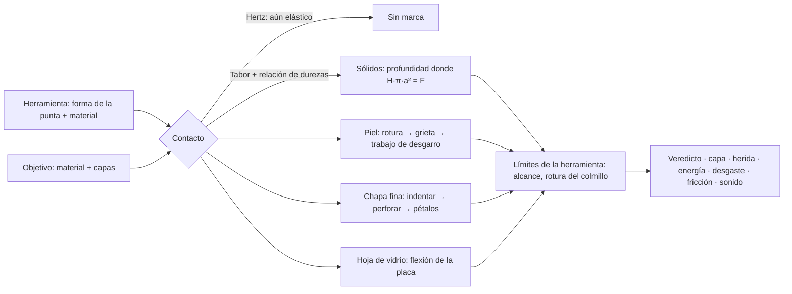

<div align="center">

[English](README.md) · **Español** · [Català](README.ca.md)


# Tribology Simulator & Industrial Workshop

**Qué raya, corta, perfora o rompe a qué, y por qué. Y cómo cortan de verdad un torno, una amoladora y una afiladora.**

Desarrollado por [Eric Valls Gramunt](https://github.com/AcidClawX41).

[](https://github.com/AcidClawX41/Scratch-Tribology-Simulator-Industrial-Workshop/releases)

[](https://github.com/AcidClawX41/Scratch-Tribology-Simulator-Industrial-Workshop/releases)
[](https://github.com/AcidClawX41/Scratch-Tribology-Simulator-Industrial-Workshop/releases)
[](https://github.com/AcidClawX41/Scratch-Tribology-Simulator-Industrial-Workshop/releases)
[](https://github.com/AcidClawX41/Scratch-Tribology-Simulator-Industrial-Workshop/releases)
[](https://github.com/AcidClawX41/Scratch-Tribology-Simulator-Industrial-Workshop/releases)

[](https://godotengine.org)
[](LICENSE)
[](#descarga)
[](https://github.com/AcidClawX41/Scratch-Tribology-Simulator-Industrial-Workshop/actions/workflows/godot-ci.yml)

</div>

Un laboratorio educativo de mecánica de contacto y tribología. Uñas humanas, garras de animales y colmillos de víbora se
ponen a prueba contra materiales que van de la piel humana al diamante, con modelos físicos publicados y datos medidos.
Cada número que enseña el programa sale de una ecuación que se puede consultar.

La versión 2.0, antes *Scratch Tribology Simulator*, se ha rehecho desde cero en **Godot 4.7.2** como un solo programa
con dos secciones:

- **Tribología biológica:** uñas, garras, colmillos y aguijones contra la piel, la madera, la carrocería de un coche, el
  vidrio y el diamante; un coche en marcha con un animal en el techo; una clínica de cetrería en 3D donde se recortan y
  se afilan garras; y una reforja que rehace una garra en otro material.
- **Taller industrial** *(en desarrollo)*: un torno con CNC compatible con Fagor, una fresadora y un taladro, una
  afiladora para cuchillos, brocas y fresas, y una amoladora contra paneles de carrocería.

Cada número en pantalla sale de un modelo o una medición publicados, o va marcado como estimación. La interfaz está en
español. El programa es gratuito, no tiene anuncios, no recoge datos y no necesita conexión a internet.

---

## Contenido

- [Tribología biológica](#tribología-biológica)
- [Taller industrial](#taller-industrial)
- [Para alumnado y profesorado de FP](#para-alumnado-y-profesorado-de-fp)
- [Capturas](#capturas)
- [La física: modelos y ecuaciones](#la-física-modelos-y-ecuaciones)
- [Materiales, tejidos y herramientas](#materiales-tejidos-y-herramientas)
- [Qué predice el modelo](#qué-predice-el-modelo)
- [Cómo se verifica la física](#cómo-se-verifica-la-física)
- [Limitaciones conocidas](#limitaciones-conocidas)
- [Descarga](#descarga)
- [Compilar desde el código](#compilar-desde-el-código)
- [Versión 1.x](#versión-1x)
- [Licencia](#licencia)
- [Autor](#autor)
- [Apoya el proyecto](#apoya-el-proyecto)

---

## Tribología biológica

- **Banco de ensayo de garras.** Eliges una herramienta, un objetivo y un método (rayar, desgarro con gancho, punción o
  golpe) y el motor calcula la presión de contacto, quién cede, hasta dónde entra y qué capa se rompe. El catálogo
  incluye formas y materiales de uña de salón, incrustaciones de gemas, 17 garras y colmillos de animales, aguijones de
  insectos y un *Velociraptor*. Los objetivos van de la piel humana por capas (cinco zonas del cuerpo, hasta el hueso) a
  la pintura de un coche, el acero, el vidrio de ventana y el templado, el zafiro y el diamante. Cualquier garra se
  puede reforjar en acero, carburo de tungsteno, zafiro o diamante. Cortes, lupas y sonido sintetizado enseñan lo que
  pasa.
- **Coche en marcha.** Un águila, un búho, un tigre, un oso o un *Velociraptor* se agarran a un coche hasta 230 km/h, y
  un casuario le pega una patada:
  - el viento sobre cada panel sale de datos de túnel de viento (DrivAer), y el agarre, el gancho de las garras y la
    velocidad a la que el animal se suelta llevan cada uno su banda de incertidumbre;
  - los saltos y los golpes dejan abolladuras, arañazos a través de cada capa de pintura, punzadas y rajas, que se ven en
    3D, de cerca y en un corte del panel;
  - en las curvas, el empuje es a = v²/R con los radios de la norma española de trazado de carreteras (3.1-IC), con
    clotoides en la S, un medidor G que cambia de lado y el reparto de carga del animal entre lados. Cada especie se
    agarra más fuerte cuanto más miedo tiene, resbala dejando marcas y, en una curva demasiado rápida, se cae a su manera;
  - las garras en el parabrisas, la luneta o una ventanilla solo rayan el vidrio si son lo bastante duras; el parabrisas
    laminado se agrieta sin caer, y el vidrio templado estalla bajo el animal;
  - un sol opcional (de mediodía o bajo) añade destellos en la pintura, el vidrio y las garras, y la cámara de
    persecución enseña una carretera sin fin entre campos, árboles y montañas.
- **Cuidado de garras en cetrería (3D).** Una clínica y un banco de cetrería con el animal entero: rapaces, un tigre, un
  oso y un *Velociraptor*.
  - Se corta, se lima y se afila cada garra con alicates, limas y un torno de uñas. Un medidor de la punta y una lupa
    enseñan cuándo la punta es natural, roma o ya una aguja. La carne viva, el calor del torno y el estrés del animal
    cuentan.
  - Un tutorial de iniciación guía cada paso, y la carrera de veterinario trae encargos, niveles y créditos.
  - Un animal mal sujeto puede reaccionar y dar un zarpazo a la cámara. La lente se raya, se raja o se mancha según la
    garra, lo afilada que esté y la lente comprada en la tienda; las marcas de animales distintos se suman en la misma
    lente. Un tutorial «tras un ataque» enseña a calmarlo.
- **Reforja experimental.** Una garra rota se puede rehacer como funda o como pieza colada. Hay un horno con ocho mandos
  y diez recetas con fuente (zafiro y rubí Verneuil, alúmina, carburo de tungsteno, diamante HPHT y CVD, acero, oro,
  titanio, vidrio), cera perdida, tallado por pasadas de minerales duros y una mesa de soldar (láser pulsado, micro-TIG
  y soldadura fuerte de plata, con su propio tutorial). Lo que es fantasía va marcado como ficción. El resultado se puede
  probar en el banco, en el coche y en la clínica de cetrería.

## Taller industrial

*En desarrollo: buena parte ya funciona, pero algunas partes están por terminar. El programa marca esta sección como
«WIP».*

- **Torno, manual y CNC.**
  - El CNC es compatible con el control Fagor 8055 T: compensación de radio G41/G42, roscado G33/G86 y subrutinas.
  - El torno 3D corta la pieza vuelta a vuelta, con las marcas de avance reales y la rugosidad medida en las crestas
    simuladas. Con taladrina, virutas y sonido de máquina.
  - Las fuerzas de corte siguen el modelo de Kienzle, con casos publicados reproducidos. Cada pieza se inspecciona
    contra un plano ISO 286 / ISO 2768 y saca una nota sobre 10.
- **Fresadora y taladro.** Páginas para una Lagun FTV 2 y una ERLO TSAR-32, con esquemas animados del corte y escenas 3D.
- **Afiladora.** Once máquinas reales, de esmeriladoras de banco a una Tormek, para cuchillos, brocas y fresas. Enseña la
  temperatura del filo, los colores de revenido y las chispas solo al afilar en seco.
- **Amoladora contra paneles de coche,** como en los rescates de bomberos. Seis discos y cuatro paneles de carrocería,
  con una limpieza del corte de 0 (limpio) a 10 (sucio), ancho de corte, rebaba, coloración por calor, pintura quemada y
  colores de las chispas (US Army TC 9-237). Es educativo, no un procedimiento de rescate.

---

## Para alumnado y profesorado de FP

El programa nació en un aula de Formación Profesional: los simuladores de torno del ciclo de *Técnico Superior en Diseño
en Fabricación Mecánica* inspiraron el taller. Está pensado para usarse en clase:

- **Gratuito, sin conexión y privado.** Sin cuentas, sin anuncios, sin recoger datos y sin conexión a internet, así que
  se puede instalar en los ordenadores del centro (Windows, Linux, macOS) y en el móvil del alumnado (Android, iPhone).
- **En español y con las fuentes a la vista.** Cada valor en pantalla dice de dónde sale, y lo que es una estimación o
  una regla de juego lo dice. El alumnado aprende a leer un resultado con espíritu crítico, no solo a aceptarlo.
- **Ciclos de fabricación mecánica** (*Mecanizado*, *Programación de la Producción en Fabricación Mecánica*, *Diseño en
  Fabricación Mecánica*):
  - programar un torno CNC en el dialecto del Fagor 8055 T, con los errores indicados por número de bloque, ciclos de
    desbaste, compensación de radio, roscado y subrutinas;
  - datos de corte (*v<sub>c</sub>*, *n*, *f*, *a<sub>p</sub>*), fuerzas de Kienzle, potencia de corte y la rugosidad que
    deja el avance;
  - inspeccionar la pieza terminada contra un plano ISO 286 / ISO 2768, con una nota sobre 10;
  - ángulos de afilado de cuchillos, brocas y fresas, velocidades máximas de las muelas (EN 12413) y los colores del
    sobrecalentamiento.
- **Clases de materiales, física y biología:** la dureza y la escala de Mohs, el contacto de Hertz, por qué una punta
  afilada entra más que una fuerte, el desgaste, por qué el vidrio se rompe sin rayarse, las capas de la piel y la
  pintura y la chapa de un coche.

**Ideas de actividades**

1. *Predecir y comprobar:* antes de pulsar «ARAÑAR», cada alumno escribe qué va a pasar y por qué; después lo compara con
   el veredicto y con la fórmula citada.
2. *Comprobarlo a mano:* tomar un resultado (una presión, una potencia de corte, la velocidad de una muela) y volver a
   calcularlo con la ecuación de la tabla de más abajo.
3. *Encontrar el error:* dar un programa Fagor con un fallo y dejar que las alarmas del simulador guíen la corrección
   antes de llevarlo a una máquina de verdad.
4. *Comparar materiales:* la misma herramienta en acero, carburo de tungsteno, zafiro y diamante contra el mismo objetivo,
   y explicar las diferencias con la relación de durezas.

Es un modelo educativo: no sustituye la formación en seguridad ni la práctica con una máquina real, y el taller sigue
marcado como en desarrollo. El código es abierto (MIT), así que el profesorado puede adaptarlo. Las sugerencias y los
errores son bienvenidos en [GitHub Issues](https://github.com/AcidClawX41/Scratch-Tribology-Simulator-Industrial-Workshop/issues).

---

## Capturas

Todas las imágenes son fotogramas del programa real (ventana de escritorio, 1240 × 880), sin montajes. Se grabaron sin
tarjeta gráfica, con el renderizador OpenGL, así que con una tarjeta gráfica con Vulkan la iluminación se ve mejor.

<table>
<tr>
<td colspan="2" align="center"></td>
</tr>
<tr>
<td colspan="2"><sub><b>Coche en marcha en una curva en S.</b> El tigre en el techo a 95 km/h en un radio de 130 m: la
carretera se curva, el coche se inclina y el medidor G pasa de derecha a izquierda con «¡Cambia de lado!». La carretera
sin fin pasa entre campos, árboles y montañas.</sub></td>
</tr>
<tr>
<td width="50%"></td>
<td width="50%"></td>
</tr>
<tr>
<td><sub><b>Demasiado rápido para la curva.</b> En una curva de 50 m, el oso de pie en el techo se agarra con las garras
de fuera, resbala hacia fuera arañando el techo y se cae al acelerar el coche de 80 a 125 km/h. Cada especie cae a su
manera.</sub></td>
<td><sub><b>Opciones de luz.</b> «Como hasta ahora», «Sol de mediodía» o «Sol bajo», con un deslizador para el rumbo del
sol. El sol se queda fijo en el mundo, así que sus destellos corren por la pintura, el vidrio y las garras al girar el
coche.</sub></td>
</tr>
<tr>
<td width="50%"></td>
<td width="50%"></td>
</tr>
<tr>
<td><sub><b>Un ataque en la clínica de cetrería.</b> Un oso sin sujetar da un zarpazo a la cámara con garras de diamante,
a cámara lenta: la lente de vidrio óptico se raja y las cinco garras la rayan. Con garras de queratina no la rayaría.</sub></td>
<td><sub><b>La misma lente, dos animales.</b> Un tigre mal anestesiado raja la lente barata de plástico con sus garras de
queratina; después, un águila con garras de acero la desgarra. Las marcas se suman, y el paño solo quita las manchas.</sub></td>
</tr>
<tr>
<td width="50%"></td>
<td width="50%"></td>
</tr>
<tr>
<td><sub><b>Cuidado de garras: el afilado.</b> Un toque del torno de uñas a 45° convierte una garra cortada y roma en una
aguja de 5 µm. El medidor de la punta y la lupa lo enseñan.</sub></td>
<td><sub><b>La mesa de soldar de la reforja.</b> Una punta de acero soldada a una funda de acero con láser pulsado, pulso
a pulso a lo largo de la costura. El veredicto: aguanta unos 504 MPa, el 72 % del metal base. Tiene su propio tutorial.</sub></td>
</tr>
<tr>
<td></td>
<td></td>
</tr>
<tr>
<td><sub><b>Un oso en el techo a 174 km/h.</b> El viento sigue cada panel a su velocidad local, la lupa enseña las
marcas de las garras y el veredicto dice que aguanta hasta unos 289 km/h, con su banda de incertidumbre.</sub></td>
<td><sub><b>Los daños de cerca.</b> El <i>Velociraptor</i> de cine raja la puerta, marcado como ficción: unas garras de
queratina reales no pueden cortar acero de endurecimiento por horneado. El recuadro enseña las capas de pintura y de
acero que ha atravesado.</sub></td>
</tr>
<tr>
<td colspan="2" align="center"></td>
</tr>
<tr>
<td colspan="2"><sub><b>Taller industrial: el torno 3D.</b> Acabado del contorno de una pieza de C45E a 1600 rpm con
taladrina. La pieza se corta vuelta a vuelta y su acabado pasa de mate a espejo.</sub></td>
</tr>
</table>

**El banco de ensayo de garras.** Fotogramas del banco de la versión 1.x, renderizados en Chromium; el banco de la 2.0
usa el mismo motor.


<sub>Una garra de águila reforjada en acero golpea un coche clásico con 72 J. La garra atraviesa entera los 0,9 mm de
acero dulce y deja un agujero de 10,5 mm abierto en pétalos. El panel absorbe 17 J del golpe.</sub>

<table>
<tr>
<td width="50%"></td>
<td width="50%"></td>
</tr>
<tr>
<td><sub><b>La piel por capas.</b> Un zarpazo de tigre de 260 N: laceración profunda hasta el músculo, tan honda como la
propia garra.</sub></td>
<td><sub><b>Corte del coche.</b> Barniz, base de color, imprimación y cataforesis sobre 900 µm de acero dulce.</sub></td>
</tr>
<tr>
<td></td>
<td></td>
</tr>
<tr>
<td><sub><b>Vidrio de ventana.</b> Una garra de oso no puede rayar el vidrio (<i>r</i> = 0,05), pero rompe la hoja al
flexarla.</sub></td>
<td><sub><b>Modo dual.</b> La misma herramienta en un coche clásico y en uno moderno: rayar, desgarrar, punzar y golpear,
con un informe de daños en milímetros y centímetros.</sub></td>
</tr>
</table>

---

## La física: modelos y ecuaciones

En la versión 2.0 toda la física está en [`godot/core/`](godot/core): GDScript sin nodos de escena, determinista, y cada
valor con su fuente y su calidad (primaria, secundaria o estimación). La interfaz solo dibuja resultados. El motor
original en JavaScript de la versión 1.x ([`packages/core`](packages/core)) está congelado y hace de oráculo: el port a
Godot reproduce sus textos, veredictos, sonidos y dibujos bit a bit. La tabla de abajo es el modelo de contacto que
comparten los dos; lo que la 2.0 añade encima (grietas cónicas de Hertz, flexión de la uña, recuperación elástica,
abolladura, vidrio templado y laminado, zonas del cuerpo hasta el hueso, el coche en marcha, la clínica de cetrería y la
reforja) está explicado en [`docs/FISICA.md`](docs/FISICA.md) y [`docs/fisica/`](docs/fisica/), y el taller en
[`docs/TALLER.md`](docs/TALLER.md). Unidades: fuerza en N, presión y dureza en MPa (1 HV = 9,807 MPa), profundidad en µm
o mm y energía en J. Cada constante tiene una fuente publicada, o va marcada como **estimación**, en
[`docs/FISICA.md`](docs/FISICA.md) (modelo v2.4, 55 referencias).



Cada modelo que usa el motor, qué hace y de dónde salen los números:

| # | Modelo · ecuación | Cómo actúa la fuerza | En el programa · fuentes |
|---|---|---|---|
| 1 | **Punta esfero-cónica**<br>$`R=\sqrt{A/\pi}`$<br>$`a=\sqrt{2Rh-h^2}`$ mientras $`h\le h_t=R(1-\sin\alpha)`$<br>$`a=R\cos\alpha+(h-h_t)\tan\alpha`$ después | La carga la soporta una zona de contacto de radio *a* que crece al hundirse la punta hasta la profundidad *h*. Una punta roma se queda en su casquete esférico, donde la profundidad crece con la fuerza. Un cono afilado llega a su flanco casi enseguida, donde la profundidad solo crece con √F, pero desde un área diminuta. Con la misma fuerza, la punta más afilada entra mucho más: **la geometría gana a la fuerza**. | Cada forma de uña, garra y colmillo; radio de punta *R* y semiángulo α en la ficha de cada herramienta · Johnson (1985) |
| 2 | **Presión nominal frente a real**<br>$`P_\mathrm{nom}=F/A`$<br>$`P_\mathrm{real}=\min(P_\mathrm{nom},\,H_\mathrm{herr},\,H_\mathrm{obj})`$<br>$`H\approx 2.8\,Y`$ | Una punta afilada «pide» F/A, a menudo varios GPa. En contacto plástico, la presión media nunca puede superar la dureza del cuerpo que cede. La carga de más solo ensancha el contacto, o aplasta la punta. | Lecturas *Presión real / nominal* · Tabor (1951) |
| 3 | **Umbral elástico (Hertz)**<br>$`\frac{1}{E^*}=(1-\nu^2)\left(\frac{1}{E_1}+\frac{1}{E_2}\right)`$<br>$`a_H=\left(\frac{3FR}{4E^*}\right)^{1/3}`$, $`p_0=\frac{3F}{2\pi a_H^2}`$<br>cede cuando $`p_0\sqrt{1+3\mu^2}\ge 1.6\,Y`$ | Antes de dejar ninguna marca, el contacto es elástico y se recupera, por dura que sea la punta. La fricción al deslizar añade cizalla (el factor de von Mises √(1+3μ²)) y adelanta la cedencia. La fracción plástica φ sube suavemente de 0 a 1. | Contacto φ. Explica por qué una uña de diamante roma resbala sobre el cuarzo a 30 N mientras una Stiletto XL lo raya · Johnson (1985) |
| 4 | **Quién cede: relación de durezas**<br>$`r=\mathrm{HV_{herr}}/\mathrm{HV_{obj}}`$<br>$`r<0.8`$: la punta se desgasta · $`r<1.25`$: marca tenue<br>$`\eta(r)=\mathrm{smoothstep}(0.8,\,2,\,r)`$, dureza efectiva $`H/\eta`$ | Una punta raya una superficie solo si es unas 1,2 veces más dura. Si no, es la punta la que se desgasta. Entre esos límites, la punta se embota mientras corta. La saturación en *r* ≈ 2 es una hipótesis del modelo. Mohs es ordinal y solo se usa como etiqueta. | Relación de durezas *r*, veredictos *NO RAYA* y *MARCA TENUE* · Tabor (1954); Richardson (1968); Pintaude (2021) |
| 5 | **Profundidad de un surco o un hoyo**<br>se resuelve $`F=\frac{H}{\eta}\,k\,\pi\,a(h)^2`$<br>$`k=1`$ (punción), $`k=\tfrac12`$ (rayado) | El flujo plástico se para donde la dureza por el área que soporta la carga equilibra la fuerza. Al rayar, solo la mitad delantera del contacto soporta carga. Multiplicadores heurísticos, marcados como tales: fracción plástica φ, tipo de rayado (0,55 / 1 / 1,7), pasadas repetidas $`n^{0.4}`$ y palanca de la garra en gancho $`1+1.3\,c`$. | Profundidad, anchura y perfil del surco · Tabor (1951); ASTM G171 |
| 6 | **Pintura sobre la carrocería**<br>$`H(h)=H_\mathrm{pintura}`$ para $`h\le 110\ \mu\mathrm{m}`$; después, $`H_\mathrm{chapa}`$ | La pintura de fábrica es un conjunto blando de polímeros de unos 20 HV: barniz de 45 µm, base de 15, imprimación de 25 y cataforesis de 25. Una garra de queratina la ara, pero se para en el acero o el aluminio, donde *r* ≈ 0,3: *HASTA EL METAL*. La punta queda embotada por la capa más dura que ha cortado. Una aleta de plástico es más blanda que el barniz, así que las garras se clavan. | Cuatro coches; corte de la pintura y de la chapa · Vodnick (2006); datos de las carrocerías más abajo |
| 7 | **Recubrimiento duro sobre sustrato blando**<br>$`H=H_\mathrm{madera}+(H_\mathrm{laca}-H_\mathrm{madera})\,e^{-a/t}`$ | Una laca dura de 30 µm sobre roble blando se hunde con la madera (el efecto cáscara de huevo). Su parte de la carga se desvanece cuando el contacto es más ancho que el espesor de la película, así que romper la laca nunca hace saltar la profundidad. | Puerta de roble barnizada · Jönsson & Hogmark (1984), simplificado |
| 8 | **Romper la piel**<br>$`F_p=190\ \mathrm{N/mm^2}\cdot A-0.66\ \mathrm{N}`$ (≥ 0,08 N)<br>golpe: $`E\ge G_p\,A`$, $`G_p=30.1\ \mathrm{kJ/m^2}`$<br>arrastre: $`F_\mathrm{ef}=N\sqrt{1+3\mu^2}\cdot\mathrm{gancho}\cdot\mathrm{palanca}`$ | La superficie es la parte de la piel más difícil de atravesar. La fuerza crece con el área de la punta: un colmillo afilado como una aguja necesita menos de 1 N, y una uña roma unos 170 N. Arrastrar una punta rompe la piel con más facilidad, por la cizalla y la tensión de la piel que tiene delante. | *Fuerza para romper la piel* · Davis et al. (2004), in vivo; Knight (1975) y Green (1978) vía Ankersen (1999) |
| 9 | **Penetración profunda en el tejido**<br>$`F=2\,J_C\,a(h)`$ con la tenacidad al corte $`J_C`$ de la capa en la punta<br>primer equilibrio donde la resistencia **cae** al cambiar de capa | Una vez pasada la dermis, la punta abre una grieta plana como una cuña. La grasa, la fascia y el músculo resisten mucho menos, así que la punta sigue hasta que una capa la para o queda enterrada entera. Un colmillo de víbora empujado con solo 4 N deja su veneno en el músculo. | Profundidad y capa de la punción (subcutánea o intramuscular) · Shergold & Fleck (2005); Pereira et al. (1997); O'Callaghan et al. (1999) |
| 10 | **Desgarros y laceraciones**<br>$`F_t=\int_0^h J_T(z)\,\mathrm{d}z`$<br>$`F_t=\mu F\cdot\mathrm{gancho}`$ (arrastre) o $`F\cdot\mathrm{palanca}`$ (desgarro con gancho) | Una garra que ha roto la piel abre un corte tan hondo como el trabajo de desgarro por milímetro que puede pagar. La tenacidad al desgarro es de 17 kJ/m² en la dermis, 4,1 en la grasa, 2,1 en la fascia y 0,84 en el músculo. Sin rotura solo hay abrasión: una línea blanca donde se levanta el estrato córneo, o arañazos donde se va la epidermis, que solo sangran tras pasadas repetidas. | Arañazo blanco → arañazos → arañazo que sangra → arañazo profundo → laceración → desgarro muscular · Comley & Fleck (2010); Kim et al. (2001); Aryeetey et al. (2022) |
| 11 | **Impacto**<br>$`\tfrac12 m v^2+F\,h=\int_0^h F_\mathrm{res}\,\mathrm{d}h`$ | Un golpe trae energía cinética, que se gasta como trabajo de penetración. Una punta afilada gasta poco por milímetro y entra mucho. Una roma la gasta en ensanchar el agujero. | 💥 Modo golpe, energía del golpe y energía absorbida · velocidades: Penning et al. (2016), Estrada et al. (2026); las masas efectivas son estimaciones |
| 12 | **Perforación de chapa fina (pétalos)**<br>$`E(l)=\sigma_0 t^2 l\left[1.23+8.9\,(l/t)^{0.4}\right]`$<br>$`F=\mathrm{d}E/\mathrm{d}h`$, $`\sigma_0=\sqrt{\sigma_y\sigma_u/(1+n)}`$ | Primero la punta indenta la pintura y el metal como un sólido, y eso pide dureza. Cuando llega a la cara de atrás, la chapa se agrieta: *PERFORA*. A partir de ahí el metal ya no resiste como un bloque. El agujero se abre en pétalos que se doblan y se desgarran, y su energía crece con el radio del agujero *l*. Pasar una garra entera cuesta decenas de julios: *ATRAVIESA*. Rayar con fuerza suficiente raja el panel: *RAJA*. | Coches y la puerta de aluminio; diámetro del agujero · Wierzbicki (1999); Atkins et al. (1998) |
| 13 | **Dureza de los paneles**<br>$`H\approx 2.8\,\sigma(\varepsilon=8\%)`$<br>$`\sigma=K\varepsilon^n`$, $`K=\sigma_u\,(e/n)^n`$ | Una misma receta convierte la curva de tracción de cada aleación en una dureza: 101 HV para el acero de endurecimiento por horneado, 92 HV para el acero dulce y 71 HV para el AA6016. La aleta de plástico de PPE/PA usa en su lugar $`H\approx 2.8\,\sigma_y`$: 13 HV. | Carrocerías · Tabor (1951); Hollomon (1945); fichas técnicas de aceros, aluminios y polímeros |
| 14 | **El vidrio de la ventana se rompe al flexar**<br>$`\sigma=\frac{3F}{2\pi t^2}\left[(1+\nu)\ln\frac{a}{r_0'}+1\right]`$<br>$`r_0'=\sqrt{1.6\,r_0^2+t^2}-0.675\,t`$<br>rompe a $`f_{g,k}=45`$ MPa, es decir, F ≈ 197 N | Rayar el vidrio pide dureza; romperlo, no. Una carga en el centro flexa la hoja, y la cara de atrás, a tracción, llega a la resistencia a flexión del vidrio. Una pata blanda puede romper una ventana. | Vidrio float recocido de 4 mm, de unos 60 cm · Roark (Young & Budynas 2002); EN 572-1 vía Saint-Gobain (2018) |
| 15 | **Fuerza de pico de un golpe en la hoja**<br>$`k=\frac{4\pi E t^3}{3a^2(3+\nu)(1-\nu)}\approx 85`$ N/mm<br>$`k_\mathrm{ef}=\left(\frac1k+\frac1{k_\mathrm{pata}}\right)^{-1}`$, $`F_\mathrm{pico}=v\sqrt{m\,k_\mathrm{ef}}`$ | La pata blanda hace de muelle en serie con la hoja y amortigua el golpe. El zarpazo de un gato llega a unos 147 N y la ventana aguanta. El de un oso llega a unos 1300 N y el de un halcón en picado a unos 1900 N, y los dos la rompen. | Resultados de la ventana · Roark; la rigidez de la pata, 10 N/mm, es una **estimación** |
| 16 | **Límites de la herramienta**<br>$`h\le\mathrm{alcance}`$<br>el colmillo se rompe por encima de 30 N (pico a lo largo del recorrido)<br>radio del agujero ≤ radio de la base (0,15 × alcance en garras, 0,04 × en colmillos) | Nada se hunde más que su propia garra o el borde libre de la uña, ni punzando ni rayando. Los colmillos de víbora hidratados se parten cerca de la punta a unos 30 N, antes de poder romper una ventana. | *(tope)* en la profundidad, *SE ROMPE LA PUNTA* · Estrada et al. (2026); las anchuras de la base son estimaciones |
| 17 | **Queratina mojada**<br>$`H,\ E\ \times\ 0.2`$ (uñas y garras naturales) | La queratina absorbe agua: del 6 % de humedad en seco al 64 % empapada. Su módulo cae de 2,34 a 0,47 GPa y su resistencia de 69 a 14 MPa, así que una uña empapada apenas raya nada. El gel, el acrílico, las gemas y la dentina no cambian. | Interruptor *Húmeda* · Farran et al. (2008, 2009); Bonser vía McKittrick et al. (2012) |
| 18 | **Modo de abrasión**<br>$`D_p=h/a`$: arado < 0,1 < cuña < 0,2 < corte | Una punta roma aparta el material formando rebordes (arado). Una afilada levanta una viruta (corte). | *Modo abrasión* · Hokkirigawa & Kato (1988) |
| 19 | **Fricción de rayado**<br>$`\mu=\mu_\mathrm{adh}+\mu_\mathrm{arado}`$, $`\mu_\mathrm{arado}\approx 0.9\,D_p`$ | La fricción al rayar es la adhesión más la fuerza que se gasta en apartar el material. Para una esfera, Bowden y Tabor dan unos 0,85·*h*/*a*. Los surcos hondos cuestan de arrastrar. | *Fricción de rayado (SCOF)* · Bowden & Tabor (1950) |
| 20 | **Desgaste**<br>$`V\propto \frac{F\,L}{H}\,f_{ab}`$ | El cuerpo más blando pierde volumen en proporción a la carga y a la distancia deslizada. El motor lo escala además por la fracción realmente arrancada: un 2 % cuando solo pule. | Índice *Desgaste Archard* (unidades arbitrarias) · Archard (1953) |
| 21 | **Adhesión (van der Waals)**<br>$`F_\mathrm{adh}=1.5\,\pi R W`$ | La atracción superficial son milinewtons a esta escala, despreciable al lado de newtons de carga. El programa la enseña para explicar por qué les importa a los gecos y no a las garras. | *Adhesión vdW (JKR)* · Johnson, Kendall & Roberts (1971) |

Las deducciones completas, cada dato con su fuente, la lista de estimaciones y las 55 referencias están en
[`docs/FISICA.md`](docs/FISICA.md).

---

## Materiales, tejidos y herramientas

### La piel humana, capa a capa

Zona de referencia: la cara posterior del brazo de un adulto, donde son típicos los arañazos y los mordiscos. Los
tejidos blandos no tienen dureza Vickers, así que cada capa se describe por su espesor, su rigidez *E* y dos
tenacidades: $`J_T`$ al desgarro y $`J_C`$ al corte.

| Capa | Profundidad | *E* | $`J_T`$ desgarro | $`J_C`$ corte | Fuentes |
|---|---|---|---|---|---|
| Estrato córneo | 0–18 µm | — | como la dermis | 1,7 kJ/m² | Sandby-Møller et al. 2003 (biopsias); Egawa et al. 2007 |
| Epidermis viva | 18–75 µm | — | como la dermis | 1,7 kJ/m² | Sandby-Møller et al. 2003. Sin vasos sanguíneos: no sangra |
| Dermis | 0,075–2,2 mm | 210 kPa | 17 kJ/m² | 1,7 kJ/m² | Gibney et al. 2010 (ecografía, 388 adultos); Iivarinen et al. 2011; Comley & Fleck 2010; Pereira et al. 1997 |
| Grasa subcutánea | 2,2–13,0 mm | 1,9 kPa | 4,1 kJ/m² | 0,41 kJ/m²\* | Gibney et al. 2010; Comley & Fleck 2010 |
| Fascia profunda | 13,0–13,3 mm | — | 2,1 kJ/m² | 0,21 kJ/m²\* | Stecco et al. 2009; Kim et al. 2001 |
| Músculo | > 13,3 mm | ≈ 53 kPa | 0,84 kJ/m² | 0,084 kJ/m²\* | Šarabon et al. 2019; Aryeetey et al. 2022 |

<sub>\* Estimaciones: la tenacidad al corte de la dermis escalada por la relación entre tenacidades al desgarro. Coincide
con el hallazgo clásico en cadáveres de que la piel es con diferencia el tejido más resistente y lo que hay debajo cede
con facilidad (Knight 1975; O'Callaghan et al. 1999).</sub>

### Coches: la misma pintura, carrocerías distintas

Los cuatro coches llevan la misma pintura de fábrica: barniz de 45 µm, base de color de 15 µm, imprimación de 25 µm y
cataforesis de 25 µm, 110 µm en total a unos 20 HV. En el plástico, la cataforesis se sustituye por un promotor de
adherencia.

| Coche | Panel de carrocería | Espesor | Dureza | Tensión de fluencia σ₀ | Fuentes |
|---|---|---|---|---|---|
| Moderno | Acero de endurecimiento por horneado HC180B (Rp0,2 180–230 MPa, +35 MPa tras el horneado de la pintura, Rm 340 MPa, n ≥ 0,17) | 0,7 mm | 101 HV | 264 MPa | Nippon Steel 2013; voestalpine 2022; I-CAR |
| Clásico | Acero dulce de embutición, tipo DC04 (Re 140–210 MPa, Rm 270–350 MPa) | ~0,9 mm (estimación) | 92 HV | 214 MPa | ArcelorMittal B10 |
| Aluminio | AA6016 tras el horneado de la pintura (Rp0,2 212 MPa, Rm 273 MPa, n 0,30) | 1,0 mm | 71 HV | 211 MPa | Hirsch 2011; Prillhofer et al. 2014 |
| Aleta de plástico | Termoplástico PPE/PA, Noryl GTX (fluencia 44–50 MPa, 1,8 GPa) | ~2,5 mm (estimación) | 13 HV | 47 MPa | SABIC; GE Plastics 2007 |

La puerta de aluminio de una casa (6063-T5 de 1,5 mm, 60 HV) usa la misma física de chapa fina. La ventana es vidrio
float recocido de 4 mm: 550 HV y 45 MPa de resistencia característica a flexión.

<details>
<summary><b>Garras y colmillos</b>: punta, longitud, fuerza y golpe</summary>

Las fuerzas de agarre de los mamíferos y las rátidas son estimaciones a partir de la masa corporal y la anatomía. Las
de las rapaces se escalan desde el gavilán de Cooper medido (Sustaita & Hertel 2010). Los golpes reparten la energía de
la pata entre sus garras. Las velocidades de las víboras están medidas (Penning et al. 2016); la carga de rotura del
colmillo, ~30 N, sale de Estrada et al. (2026).

| Garra / colmillo | Área de la punta · semiángulo | Longitud útil | Fuerza | Golpe ½·m·v² |
|---|---|---|---|---|
| Gato | 0,02 mm² · 14° | 10 mm | 15 N | 4 m/s × 0,15 kg = 1,2 J |
| Tigre | 0,06 mm² · 16° | 40 mm | 260 N | 8 m/s × 3 kg = 96 J |
| Oso pardo | 0,5 mm² · 26° | 60 mm | 300 N | 7 m/s × 4 kg = 98 J |
| Águila | 0,04 mm² · 15° | 35 mm | 110 N | 12 m/s × 1 kg = 72 J |
| Águila arpía | 0,06 mm² · 15° | 40 mm | 200 N | 9 m/s × 1,8 kg = 73 J |
| Halcón peregrino (en picado) | 0,02 mm² · 15° | 18 mm | 15 N | 40 m/s × 0,25 kg = 200 J |
| Búho | 0,03 mm² · 15° | 30 mm | 45 N | 6 m/s × 0,5 kg = 9,0 J |
| Lechuza | 0,015 mm² · 13° | 15 mm | 8 N | 5 m/s × 0,08 kg = 1,0 J |
| Buitre leonado | 0,3 mm² · 28° | 25 mm | 60 N | 2 m/s × 1 kg = 2,0 J |
| Casuario (garra interior) | 0,05 mm² · 14° | 110 mm | 500 N | 8 m/s × 5 kg = 160 J |
| Emú | 0,12 mm² · 22° | 40 mm | 300 N | 7 m/s × 2,5 kg = 61 J |
| Avestruz | 0,35 mm² · 32° | 60 mm | 900 N | 10 m/s × 8 kg = 400 J |
| Espolón de gallo | 0,04 mm² · 16° | 25 mm | 40 N | 5 m/s × 0,4 kg = 5,0 J |
| Guacamayo | 0,03 mm² · 18° | 15 mm | 25 N | 1,5 m/s × 0,1 kg = 0,1 J |
| Pájaro pequeño | 0,02 mm² · 16° | 4 mm | 1,5 N | 1 m/s × 0,01 kg = 0,005 J |
| Colmillo de víbora | 0,008 mm² · 17° | 18 mm | 4 N | 2,8 m/s × 0,35 kg = 1,4 J |
| Colmillo de víbora del Gabón | 0,012 mm² · 15° | 50 mm | 20 N | 2,5 m/s × 1 kg = 3,1 J |

Uñas: cuadrada 9 mm² · 75°, redonda 3,5 mm² · 65°, ataúd 2,8 mm² · 55°, almendra 0,9 mm² · 40°, stiletto 0,15 mm² · 22°
y Stiletto XL 0,08 mm² · 16° (borde libre de 4 a 12 mm). Uña natural: ~25 HV, E 2,9 GPa (nanoindentación, Tohmyoh et al.
2023).

</details>

---

## Qué predice el modelo

Calculado por el propio motor, con los mismos números que enseña el programa (el modelo de la tabla de arriba; varios de
estos casos están fijados por tests). Los caminos de decisión que sigue el motor para cada tipo de objetivo están
dibujados en [`docs/README-1.x.md`](docs/README-1.x.md#decision-paths-case-by-case) (en inglés).

| Ensayo | Resultado | Por qué |
|---|---|---|
| Uña almendra, 4 N, piel | Arañazo blanco: levanta los 18 µm del estrato córneo | Romper la piel con esa punta pediría ~170 N |
| Uña almendra, 30 N × 20 pasadas, piel | Arañazos que sangran (75 µm) | La excoriación repetida llega a los capilares de la dermis papilar |
| Garra de gato, 15 N, piel | Arañazo profundo, 0,69 mm, sangra | La garra afilada rompe la piel desde 3,1 N |
| Garra de gato, 15 N, desgarro con gancho | Desgarro profundo, 1,8 mm | La garra curva tira con toda su fuerza en vez de solo con la fricción |
| Garra de tigre, 260 N, piel | Laceración profunda hasta el músculo, 40 mm, la garra entera (*tope*) | Pasada la dermis, la grasa y el músculo se desgarran con poco trabajo |
| Colmillo de víbora empujado con 4 N, piel | Punción: veneno a 18 mm, en el músculo | Punta de aguja: la piel se rompe a 0,86 N, y después *F* = 2·*J_C*·*a* es pequeña |
| Uña natural, 30 N, vidrio de ventana | No raya (*r* = 0,05) | Queratina (25 HV) contra vidrio (550 HV): se desgasta la uña |
| Uña con diamante, 30 N, zafiro | Surco de 4,4 µm, modo cuña | *r* = 5 (10 000 frente a 2000 HV). Una piedra de zafiro sobre zafiro (*r* = 1) solo pule: marca tenue |
| Stiletto XL de diamante, cuarzo: 4 N frente a 30 N | Nada (φ = 5 %) frente a un surco de 5,3 µm | Por debajo del inicio de la cedencia de Hertz, el contacto es elástico |
| Uña cuadrada de diamante, 30 N, cuarzo | Resbala sin marcar (φ = 0 %) | Una punta roma reparte la carga: la geometría gana a la dureza |
| Uña almendra sobre la pintura de un coche, 30 N: seca frente a empapada | Arañazo de 30 µm en el barniz frente a un remolino que se pule | La queratina empapada conserva solo ~20 % de su dureza |
| Garra de oso rayando a 300 N: coche moderno frente a aleta de plástico | Se para en el metal (110 µm) frente a 1,0 mm dentro del plástico | La queratina no corta el acero (*r* ≈ 0,26); el PPE/PA es más blando que la queratina |
| Golpe de garra de águila reforjada en acero (72 J): coche clásico, moderno y de aluminio | Atraviesa los tres: agujero de Ø 10,5 mm; el panel absorbe 17, 14 y 20 J | La energía de los pétalos escala con σ₀·t²: el acero dulce más grueso y el aluminio cuestan más |
| Pinchazo con una uña stiletto de metal macizo (5 J): coche moderno frente a clásico | Perfora los dos: la punta sale 5,3 frente a 4,3 mm; agujero de Ø 5,2 frente a 4,6 mm | El panel moderno, más fino, cede con más facilidad |
| Zarpazo a una ventana: gato frente a oso, y el picado de un halcón | Gato: la hoja aguanta (147 N < 197 N). Oso (~1300 N) y halcón (~1900 N): se rompe | Fuerza de pico con la rigidez de la pata en serie |
| Colmillo de víbora empujado a 40 N contra un vidrio | El colmillo se rompe (~30 N) | Carga de rotura del colmillo (Estrada et al. 2026) |
| Patada a una puerta de roble de 35 mm: casuario (160 J) frente a avestruz (400 J) | El casuario la atraviesa (Ø 18,5 mm); la garra del avestruz se queda clavada a 25,5 mm | Garra en daga de 14° frente a garra roma de 32°: el filo gana a la energía |

---

## Cómo se verifica la física

- **Más de 1700 tests automáticos en Godot** (`npm run godot:test`), que se ejecutan sin ventana en cada subida con
  [`godot-ci.yml`](.github/workflows/godot-ci.yml):
  - **El oráculo de la 1.x:** los 40 escenarios de referencia y una muestra determinista de unos 20 000 ensayos del banco
    exportados del motor JavaScript congelado. El port tiene que coincidir en sus veredictos, capas, sonidos y textos,
    con los números a 1e-9 relativo, y en sus dibujos SVG byte a byte.
  - **Una referencia de la 2.0** para la física nueva: un cambio a propósito tiene que regenerarla y explicar qué casos
    se mueven y por qué.
  - **Invariantes físicas**, por ejemplo: más fuerza nunca da menos profundidad; una punta más afilada nunca raya menos
    hondo; una garra más dura nunca marca menos la misma lente; un golpe nunca penetra menos que un empuje estático; nada
    entra más que su propia garra; la queratina nunca corta el acero.
  - **Sin deriva de coma flotante:** las matemáticas del núcleo usan copias exactas al bit de las funciones de V8, así
    que cada plataforma escribe los mismos números; un test falla si se usa la libm de la plataforma.
  - **Tests de la interfaz:** cada página cabe en una pantalla de teléfono de 390 × 844, en las escenas 3D no se crea
    nada en cada fotograma, presupuestos de fotograma en escritorio y teléfono, y cada sonido dentro de la banda de
    volumen de su clase.
- **El motor de la 1.x** conserva sus 115 tests (`npm test`) y su barrido del catálogo completo (`npm run audit`: 603 228
  ensayos sin ningún texto roto, valor no finito ni profundidad imposible).
- **Regla de honestidad:** cada valor nuevo necesita una fuente publicada, o va marcado como estimación en el programa y
  en [`docs/FISICA.md`](docs/FISICA.md), que guarda la tabla de estimaciones. Lo que es fantasía (el *Velociraptor* de
  cine, recubrir una garra viva) va marcado como ficción.

---

## Limitaciones conocidas

Es un **modelo educativo**. Acierta las tendencias y los órdenes de magnitud; no es un ensayo de laboratorio, ni una
herramienta forense o médica, ni un procedimiento de taller o de rescate.

- Chapas finas: los pétalos suponen fractura dúctil sin efecto de la velocidad de deformación, y la misma fórmula se usa
  para la aleta de plástico. La abolladura está calibrada con una sola medición, y lo que hay detrás de un panel
  (refuerzos, el panel interior) no se modela.
- Vidrio: los radios de las ventanillas son estimaciones geométricas. La constante de las grietas cónicas de Hertz
  sobrestima las cargas medidas entre 1,7 y 2,6 veces hasta que se pueda comprobar la medición del vidrio sodocálcico.
- Las uñas se tratan como puntas esfero-cónicas, no como filos.
- Coche en marcha: unas garras trabadas en la aleta de plástico la rajan solo en un golpe de costado; con el viento por
  detrás, la postura de las alas de una rapaz no se conoce y se toma la que más sube.
- Muchas fuerzas de animales, masas de golpe, secciones de garras y valores de juego (niveles, créditos) son
  estimaciones o reglas de juego, y van marcados como tales.
- Taller industrial: las fuerzas y la potencia tienen una incertidumbre de ±30–45 % por la dispersión entre fuentes; la
  vida de la herramienta, la forma de la viruta, el filo recrecido, el inicio del *chatter* y la temperatura del filo no
  se predicen, solo se enseñan como tendencias.

La lista completa y al día está en [`docs/FISICA.md`](docs/FISICA.md#limitaciones-conocidas); el trabajo previsto, en
[`docs/ROADMAP.md`](docs/ROADMAP.md).

---

## Descarga

Las versiones para cada plataforma se publican en la
[página de Releases](https://github.com/AcidClawX41/Scratch-Tribology-Simulator-Industrial-Workshop/releases) con GitHub Actions
([`godot-release.yml`](.github/workflows/godot-release.yml)) en cada etiqueta `v2*`:

| Plataforma | Archivo | Primera vez |
|---|---|---|
| Windows 10/11 (64 bits) | `…_windows-x86_64.zip` | Descomprímelo y abre `TribologySimulatorWorkshop.exe`. No va firmado: SmartScreen → *Más información* → *Ejecutar de todos modos* |
| macOS 11+ (Intel) · 13+ (Apple Silicon) | `…_macos-universal.dmg` | Firma ad hoc, sin notarizar: ábrelo una vez y después *Ajustes del Sistema → Privacidad y seguridad → Abrir igualmente* |
| Linux x86_64 | `…_linux-x86_64.AppImage` · `…_amd64.deb` · `…_linux-x86_64.tar.gz` | AppImage: `chmod +x` y ábrelo. Debian/Ubuntu: `sudo apt install ./…_amd64.deb` |
| Android 7.0+ | `…_android.apk` | Permite *Instalar aplicaciones desconocidas* en tu navegador o gestor de archivos |
| iPhone / iPad (iOS 15+) | `…_ios-unsigned.ipa` | Sin firmar: instálala con AltStore o Sideloadly, que la firman con tu ID de Apple (las cuentas gratuitas tienen que reinstalarla cada 7 días) |

La versión 2.0 se instala encima de la 1.x: los identificadores de los paquetes no han cambiado.

---

## Compilar desde el código

Requisitos: Node 20 o posterior y Godot 4.7.2 (el editor estándar, no el .NET). El script de preparación descarga la
versión oficial y comprueba su suma SHA-512.

```bash
npm run godot:setup                       # Godot 4.7.2 en .godot-home/bin (añade -- --templates para las plantillas de exportación)
npm run godot:test                        # todos los tests de Godot: la física contra el oráculo 1.x, el taller y la interfaz
npm run godot:test -- --filter=taller/    # una carpeta o un archivo
```

Después importa `godot/project.godot` en el gestor de proyectos de Godot y pulsa **F5**. Las escenas de demostración, las
pruebas de rendimiento y las capturas se explican en [`godot/README.md`](godot/README.md), y la exportación a cada
plataforma en [`docs/GODOT-EXPORT.md`](docs/GODOT-EXPORT.md).

```
godot/core/       física, datos y dibujo, sin nodos: shared/, lab/ (biología), taller/ (taller)
godot/app/        escenas e interfaz
godot/tests/      ejecutor de tests y tests
packages/core/    el motor JavaScript de la 1.x, congelado: el oráculo
apps/             las apps de la 1.x (escritorio y web con Tauri, móvil con Expo)
docs/             documentación de la física, del taller y de la exportación
```

---

## Versión 1.x

La versión 1.x, **Scratch Tribology Simulator**, es la app original de escritorio y web en React/Tauri, con una app móvil
en Expo. Sus instaladores siguen en la página de Releases (etiquetas `v1*`). Su README, con la tabla completa de modelos
de contacto, los datos de la piel y de los coches, las predicciones y los caminos de decisión, se guarda en
[`docs/README-1.x.md`](docs/README-1.x.md) (en inglés).

---

## Licencia

Tribology Simulator & Industrial Workshop se publica con la [licencia MIT](LICENSE).
Copyright © 2026 Eric Valls Gramunt.

Puedes usarlo, copiarlo, modificarlo y redistribuirlo, con fines comerciales o no, siempre que se conserven el aviso de
copyright y el texto de la licencia. Se ofrece sin ninguna garantía.

La versión 2.0 está hecha con el motor Godot (MIT). Las fuentes, Syne y Space Mono, y el subconjunto de Noto Color Emoji
tienen la licencia SIL Open Font License 1.1. El software de terceros de cada versión y sus licencias están en
[`THIRD-PARTY-NOTICES.md`](THIRD-PARTY-NOTICES.md). Las fuentes científicas citadas en la documentación pertenecen a sus
autores y editores.

---

## Autor

**Eric Valls Gramunt** · [@AcidClawX41](https://github.com/AcidClawX41)

---

## Apoya el proyecto

El programa es gratuito, sin anuncios y no recoge datos. Si te ha sido útil, o simplemente te ha gustado, puedes
invitarme a un café o apoyar su desarrollo:

- [GitHub Sponsors](https://github.com/sponsors/AcidClawX41)
- [Ko-fi](https://ko-fi.com/ericdev)
- [PayPal](https://paypal.me/EricValls)

Los mismos enlaces están detrás del botón «Dona o invítame», en las dos secciones del programa. Se abren en tu
navegador: el programa en sí nunca se conecta a nada.
