<div align="center">

**English** · [Español](README.es.md) · [Català](README.ca.md)

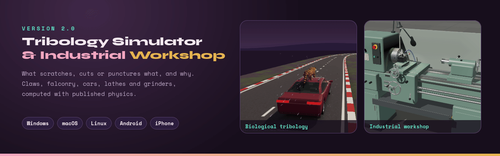

# Tribology Simulator & Industrial Workshop

**What scratches, cuts, punctures or breaks what — and why. And how a lathe, a grinder and a sharpener really cut.**

Developed by [Eric Valls Gramunt](https://github.com/AcidClawX41).

[](https://github.com/AcidClawX41/Scratch-Tribology-Simulator/releases)

[](https://github.com/AcidClawX41/Scratch-Tribology-Simulator/releases)
[](https://github.com/AcidClawX41/Scratch-Tribology-Simulator/releases)
[](https://github.com/AcidClawX41/Scratch-Tribology-Simulator/releases)
[](https://github.com/AcidClawX41/Scratch-Tribology-Simulator/releases)
[](https://github.com/AcidClawX41/Scratch-Tribology-Simulator/releases)

[](https://godotengine.org)
[](LICENSE)
[](#download)
[](https://github.com/AcidClawX41/Scratch-Tribology-Simulator/actions/workflows/godot-ci.yml)

</div>

An educational contact-mechanics and tribology laboratory. Human nails, animal claws and viper fangs are tested
against materials from human skin to diamond, using published physical models and measured data. Every number the
program shows comes from an equation you can look up.

Version 2.0, formerly *Scratch Tribology Simulator*, is rebuilt from scratch in **Godot 4.7.2** as one program with
two sections:

- **Biological tribology:** nails, claws, fangs and stings against skin, wood, car bodies, glass and diamond; a moving
  car with an animal on the roof; a 3D falconry clinic where you trim and sharpen claws; and a forge that rebuilds a
  claw in another material.
- **Industrial workshop** *(work in progress)*: a lathe with a Fagor-compatible CNC, a milling machine and a drill, a
  sharpener for knives, drills and end mills, and an angle grinder against car body panels.

Every number on screen comes from a published model or measurement, or is labelled as an estimate. The interface is
in Spanish. The program is free, has no ads, collects no data and needs no network connection.


---

## Contents

- [Biological tribology](#biological-tribology)
- [Industrial workshop](#industrial-workshop)
- [For vocational training students and teachers](#for-vocational-training-students-and-teachers)
- [Screenshots](#screenshots)
- [The physics: models and equations](#the-physics-models-and-equations)
- [Materials, tissues and tools](#materials-tissues-and-tools)
- [What the model predicts](#what-the-model-predicts)
- [How the physics is verified](#how-the-physics-is-verified)
- [Known limitations](#known-limitations)
- [Download](#download)
- [Build from source](#build-from-source)
- [Version 1.x](#version-1x)
- [License](#license)
- [Author](#author)
- [Support the project](#support-the-project)

---

## Biological tribology

- **Claw lab (test bench).** Pick a tool, a target and a method (scratch, hooked tear, puncture or strike) and the
  engine works out the contact pressure, who yields, how deep it goes and which layer gives way. The catalogue covers
  nail shapes and salon materials, gem inlays, 17 animal claws and fangs, insect stings and a *Velociraptor*.
  Targets range from layered human skin (five body zones, down to the bone) to car paint, steel, window and tempered
  glass, sapphire and diamond. Any claw can be reforged in steel, tungsten carbide, sapphire or diamond. Cross-sections,
  magnifiers and synthesized sound show what happens.
- **Moving car.** An eagle, an owl, a tiger, a bear or a *Velociraptor* holds on to a car at up to 230 km/h, and a
  cassowary kicks it:
  - the wind over each panel comes from wind-tunnel data (DrivAer), and the grip, the hook of the claws and the speed
    at which the animal lets go each come with their band of uncertainty;
  - jumps and strikes leave dents, scratches through each paint layer, punctures and slits, shown in 3D, in a
    close-up and in a cross-section of the panel;
  - in curves, the pull is a = v²/R on road radii from the Spanish road design standard (3.1-IC), with clothoids in
    the S-bend, a G-meter that flips side and the animal's load on each side. Each species grips harder as its fear
    grows, slips leaving marks and, in a curve taken too fast, falls off in its own way;
  - claws on the windscreen, the rear window or a side window scratch the glass only when they are hard enough; the
    laminated windscreen cracks without falling, and tempered glass shatters under the animal;
  - an optional sun (midday or low) adds glints on the paint, the glass and the claws, and the chase camera shows an
    endless road between fields, trees and mountains.
- **Falconry Claw Care (3D).** A clinic and a falconry bench with the whole animal: raptors, a tiger, a bear and a
  *Velociraptor*.
  - You trim, file and sharpen each claw with clippers, files and a rotary nail grinder. A tip meter and a magnifier
    show when the tip is natural, blunt or already a needle. The quick, the heat of the grinder and the animal's
    stress all count.
  - A beginner's tutorial guides each step, and a vet career brings jobs, levels and credits.
  - An animal that is not held properly may react and strike the camera. The lens scratches, cracks or smears
    depending on the claw, its sharpness and the lens bought in the shop; the marks of different animals add up on the
    same lens. An «after an attack» tutorial shows how to calm it.
- **Experimental forge.** A broken claw can be rebuilt as a cap or a cast piece. There is a furnace with eight
  controls and ten sourced recipes (Verneuil sapphire and ruby, alumina, tungsten carbide, HPHT and CVD diamond, steel,
  gold, titanium, glass), lost-wax casting, pass-by-pass cutting of hard minerals and a welding table (pulsed laser, micro-TIG and silver
  brazing, with its own tutorial). Anything that is fantasy is
  marked as fiction. The result can be tried on the bench, on the car and in the falconry clinic.

## Industrial workshop

*Work in progress: much of it already works, but some parts are still being finished. The program marks this section
«WIP».*

- **Lathe, manual and CNC.**
  - The CNC is compatible with the Fagor 8055 T control: tool radius compensation G41/G42, threading G33/G86 and
    subroutines.
  - The 3D lathe cuts the part revolution by revolution, with real feed marks and the roughness measured on the
    simulated crests. Coolant, chips and machine sound come with it.
  - Cutting forces follow Kienzle's model, with published cases reproduced. Each part is inspected against an
    ISO 286 / ISO 2768 drawing and gets a mark out of 10.
- **Milling machine and drill.** Pages for a Lagun FTV 2 and an ERLO TSAR-32, with animated diagrams of the cut and
  3D scenes.
- **Sharpener.** Eleven real machines, from bench grinders to a Tormek, for knives, drills and end mills. It shows the
  edge temperature, the tempering colours and sparks only when grinding dry.
- **Angle grinder against car panels,** as used in fire-brigade rescues. Six discs and four body panels, with a cut
  cleanliness from 0 (clean) to 10 (dirty), kerf, burr, heat tint, burnt paint and spark colours (US Army TC 9-237).
  It is educational, not a rescue procedure.

---

## For vocational training students and teachers

The program was born in a vocational training (FP) classroom: the lathe simulators of the *Técnico Superior en Diseño
en Fabricación Mecánica* course inspired the workshop. It is built to be used in class:

- **Free, offline and private.** No accounts, no ads, no data collected and no network connection, so it can be
  installed on school computers (Windows, Linux, macOS) and on students' own phones (Android, iPhone).
- **In Spanish, with the sources in sight.** Every value on screen shows where it comes from, and what is an estimate
  or a game rule says so. Students learn to read a result critically, not just to accept it.
- **Mechanical manufacturing courses** (*Mecanizado*, *Programación de la Producción en Fabricación Mecánica*,
  *Diseño en Fabricación Mecánica*):
  - programming a CNC lathe in the Fagor 8055 T dialect, with errors reported by block number, roughing cycles,
    tool radius compensation, threading and subroutines;
  - cutting data (*v<sub>c</sub>*, *n*, *f*, *a<sub>p</sub>*), Kienzle forces, cutting power and the roughness left by
    the feed;
  - inspecting the finished part against an ISO 286 / ISO 2768 drawing, with a mark out of 10;
  - sharpening angles for knives, drills and end mills, grinding-wheel speed limits (EN 12413) and the colours of
    overheating.
- **Materials, physics and biology classes:** hardness and the Mohs scale, Hertz contact, why a sharp tip goes deeper
  than a strong one, wear, why glass breaks without being scratched, skin layers, and a car's paint and panels.

**Ideas for activities**

1. *Predict, then test:* before pressing «ARAÑAR», each student writes down what will happen and why; then they
   compare with the verdict and the cited formula.
2. *Check it by hand:* take one result (a pressure, a cutting power, a wheel speed) and recompute it with the
   equation from the table below.
3. *Find the error:* give a Fagor program with a mistake and let the simulator's alarms guide the fix before
   running it on a real machine.
4. *Compare materials:* the same tool in steel, tungsten carbide, sapphire and diamond against the same target, and
   explain the differences with the hardness ratio.

It is an educational model: it does not replace safety training or practice on a real machine, and the workshop is
still marked as work in progress. The code is open (MIT), so teachers can adapt it. Suggestions and errors are welcome
on [GitHub Issues](https://github.com/AcidClawX41/Scratch-Tribology-Simulator/issues).

---

## Screenshots

All images are frames from the real program (desktop window, 1240 × 880), with no mock-ups. They were recorded without a
GPU, with the OpenGL renderer, so on a graphics card with Vulkan the lighting looks better.

<table>
<tr>
<td colspan="2" align="center">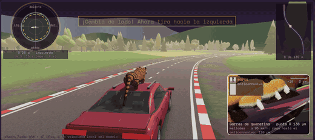</td>
</tr>
<tr>
<td colspan="2"><sub><b>Moving car in an S-bend.</b> The tiger on the roof at 95 km/h on a 130 m radius: the road
curves, the car leans and the G-meter flips from right to left with «¡Cambia de lado!» («it changes side»). The endless
road runs between fields, trees and mountains.</sub></td>
</tr>
<tr>
<td width="50%">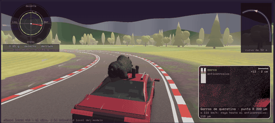</td>
<td width="50%">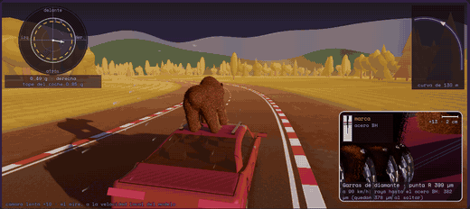</td>
</tr>
<tr>
<td><sub><b>Too fast for the curve.</b> On a 50 m curve, the bear standing on the roof grips with its outer claws,
slips outwards scratching the roof and falls off as the car speeds up from 80 to 125 km/h. Each species falls in its own way.</sub></td>
<td><sub><b>Light options.</b> «As before», «Midday sun» or «Low sun», with a slider for the sun's heading. The sun
stays fixed in the world, so its glints run across the paint, the glass and the claws as the car turns.</sub></td>
</tr>
<tr>
<td width="50%">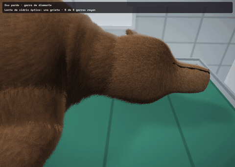</td>
<td width="50%">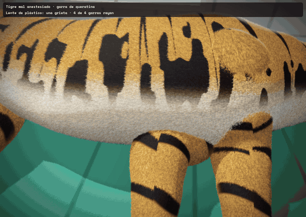</td>
</tr>
<tr>
<td><sub><b>An attack in the falconry clinic.</b> A bear left unrestrained swipes at the camera with diamond claws, in
slow motion: the optical glass lens cracks and all five claws scratch it. Keratin claws could not scratch it.</sub></td>
<td><sub><b>The same lens, two animals.</b> A badly sedated tiger cracks the cheap plastic lens with its keratin claws;
then an eagle with steel claws tears it. The marks add up, and the cloth only removes the smears.</sub></td>
</tr>
<tr>
<td width="50%">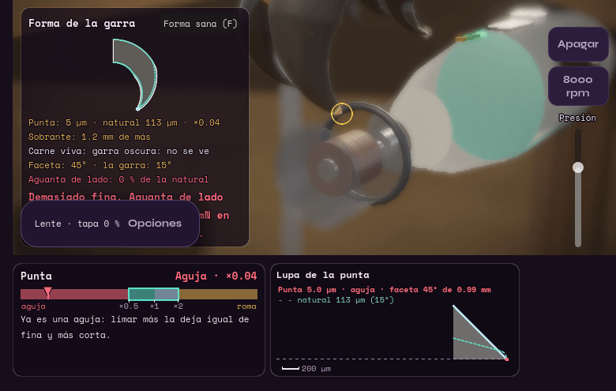</td>
<td width="50%">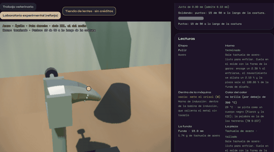</td>
</tr>
<tr>
<td><sub><b>Claw Care: sharpening.</b> One touch of the rotary grinder at 45° turns a clipped, blunt claw into a
5 µm needle. The tip meter and the magnifier show it.</sub></td>
<td><sub><b>The forge's welding table.</b> A steel tip welded onto a steel sheath with a pulsed laser, pulse by pulse
along the seam. The verdict: it holds about 504 MPa, 72 % of the base metal. It has its own tutorial.</sub></td>
</tr>
<tr>
<td>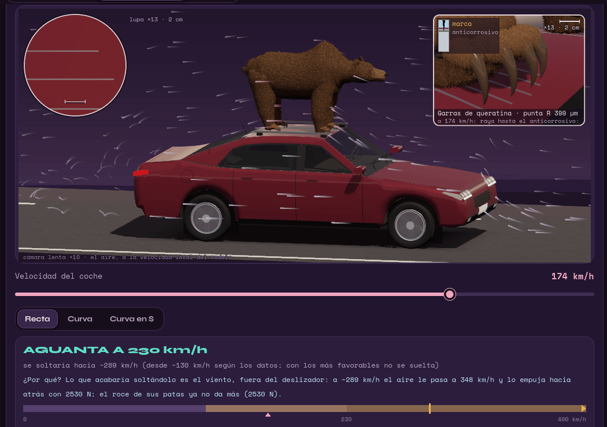</td>
<td>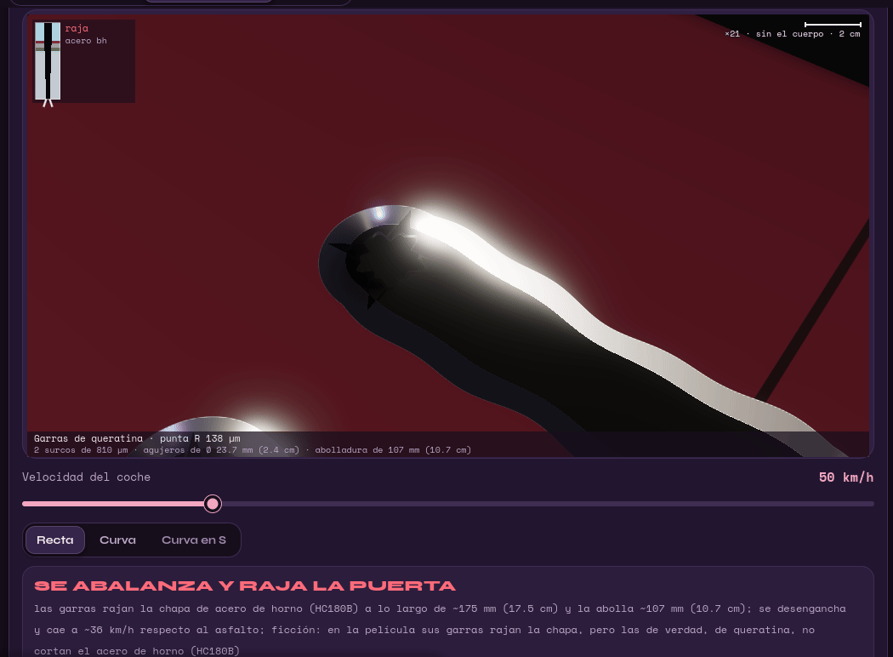</td>
</tr>
<tr>
<td><sub><b>A bear on the roof at 174 km/h.</b> The wind follows each panel at its local speed, the magnifier shows
the claw marks, and the verdict says it holds on up to about 289 km/h, with its band of uncertainty.</sub></td>
<td><sub><b>Damage close-up.</b> The film <i>Velociraptor</i> slits the door open, marked as fiction: real keratin
claws cannot cut bake-hardening steel. The inset shows the paint and steel layers it went through.</sub></td>
</tr>
<tr>
<td colspan="2" align="center">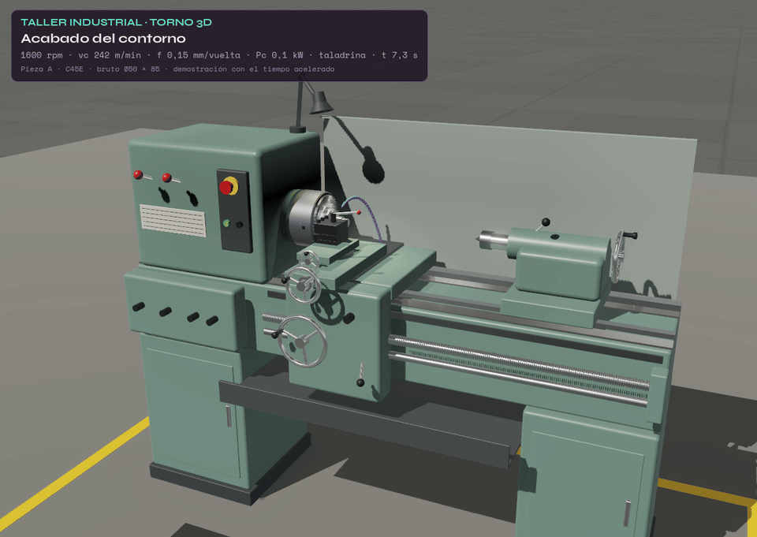</td>
</tr>
<tr>
<td colspan="2"><sub><b>Industrial workshop: the 3D lathe.</b> Finishing the contour of a C45E part at 1600 rpm with
coolant. The part is cut revolution by revolution, and its finish goes from matte to mirror.</sub></td>
</tr>
</table>

**The claw lab (test bench).** Frames from the 1.x build of the bench, rendered in Chromium; the 2.0 bench runs the
same engine.

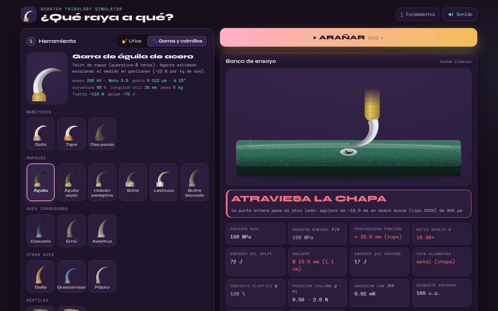

<sub>An eagle talon reforged in steel strikes a classic car with 72 J. The talon passes all the way through 0.9 mm of
mild steel and leaves a 10.5 mm petalled hole. The panel absorbs 17 J of the strike.</sub>

<table>
<tr>
<td width="50%">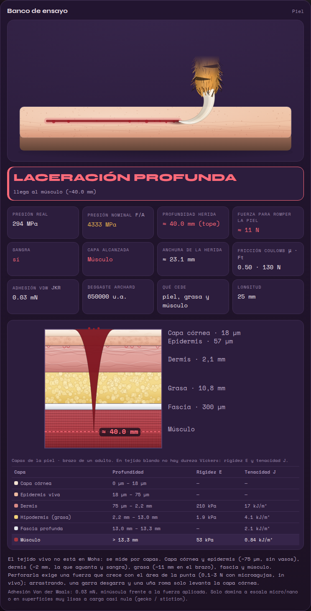</td>
<td width="50%">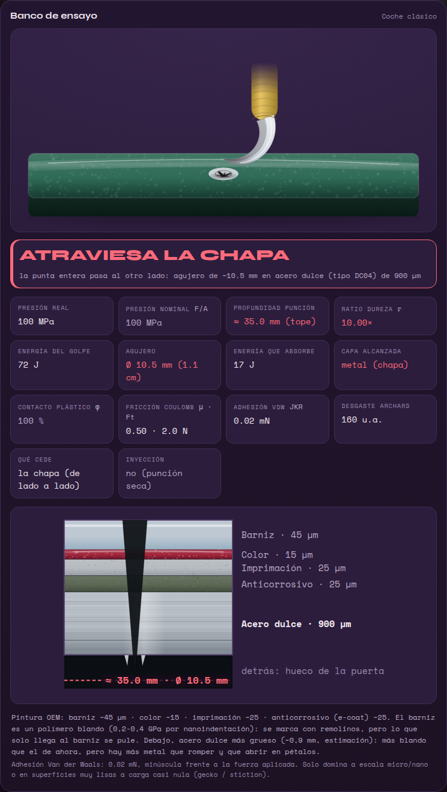</td>
</tr>
<tr>
<td><sub><b>Layered skin.</b> A 260 N tiger swipe: deep laceration to the muscle, as deep as the claw itself.</sub></td>
<td><sub><b>Car cross-section.</b> Clearcoat, basecoat, primer and e-coat over 900 µm of mild steel.</sub></td>
</tr>
<tr>
<td>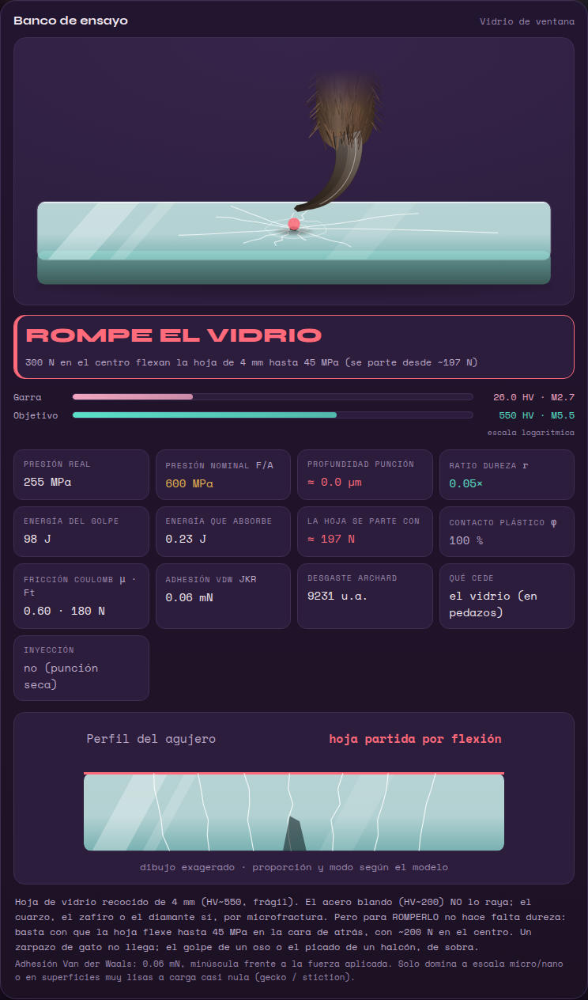</td>
<td>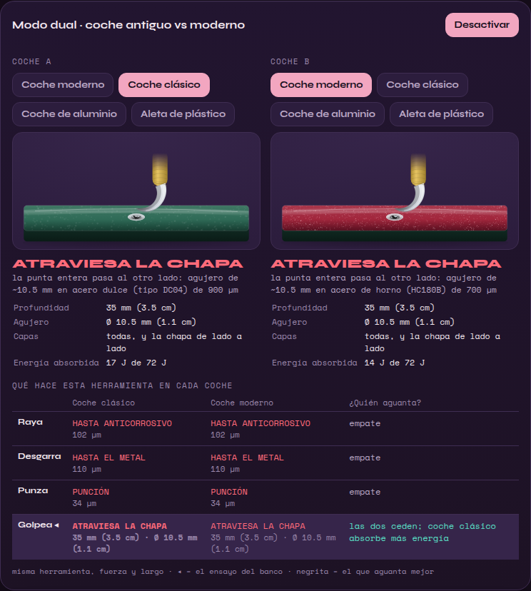</td>
</tr>
<tr>
<td><sub><b>Window glass.</b> A bear claw can't scratch glass (<i>r</i> = 0.05), but it breaks the pane by bending it.</sub></td>
<td><sub><b>Dual mode.</b> The same tool on a classic and a modern car: scratch, tear, puncture and strike, with a
damage report in millimetres and centimetres.</sub></td>
</tr>
</table>

---

## The physics: models and equations

In version 2.0 all physics lives in [`godot/core/`](godot/core): GDScript with no scene nodes, deterministic, and
every value carrying its source and its quality (primary, secondary or estimate). The interface only draws results.
The original JavaScript engine of version 1.x ([`packages/core`](packages/core)) is frozen and acts as an oracle: the
Godot port reproduces its texts, verdicts, sounds and drawings bit for bit. The table below is the core contact model
both share; what 2.0 adds on top (Hertzian cone cracks, nail bending, elastic recovery, denting, tempered and
laminated glass, body zones down to the bone, the moving car, the falconry clinic and the forge) is written up in
[`docs/FISICA.md`](docs/FISICA.md) and [`docs/fisica/`](docs/fisica/), and the workshop in [`docs/TALLER.md`](docs/TALLER.md).
Units: force in N, pressure and hardness in MPa (1 HV = 9.807 MPa), depth in µm or mm, energy in J.
Every constant has a published source, or is flagged as an **estimate**, in
[`docs/FISICA.md`](docs/FISICA.md) (model v2.4, 55 references, in Spanish).

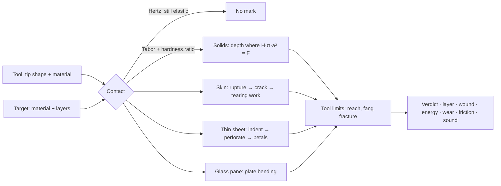

Every model the engine uses, what it does and where the numbers come from:

| # | Model · equation | How the force acts | In the app · sources |
|---|---|---|---|
| 1 | **Sphero-conical tip**<br>$`R=\sqrt{A/\pi}`$<br>$`a=\sqrt{2Rh-h^2}`$ while $`h\le h_t=R(1-\sin\alpha)`$<br>$`a=R\cos\alpha+(h-h_t)\tan\alpha`$ beyond | The load is carried by a contact patch of radius *a* that grows as the tip sinks to depth *h*. A blunt tip stays on its spherical cap, where depth grows with the force. A sharp cone reaches its flank almost at once, where depth grows only with √F but from a tiny area. At equal force, the sharper tip goes much deeper: **geometry beats force**. | Every nail shape, claw and fang; tip radius *R* and half-angle α on each tool card · Johnson (1985) |
| 2 | **Nominal vs real pressure**<br>$`P_\mathrm{nom}=F/A`$<br>$`P_\mathrm{real}=\min(P_\mathrm{nom},\,H_\mathrm{tool},\,H_\mathrm{target})`$<br>$`H\approx 2.8\,Y`$ | A sharp tip "asks" for F/A, often several GPa. In plastic contact the mean pressure can never exceed the hardness of whichever body yields. Extra load just widens the contact, or flattens the tip. | *Presión real / nominal* metrics · Tabor (1951) |
| 3 | **Elastic threshold (Hertz)**<br>$`\frac{1}{E^*}=(1-\nu^2)\left(\frac{1}{E_1}+\frac{1}{E_2}\right)`$<br>$`a_H=\left(\frac{3FR}{4E^*}\right)^{1/3}`$, $`p_0=\frac{3F}{2\pi a_H^2}`$<br>yields when $`p_0\sqrt{1+3\mu^2}\ge 1.6\,Y`$ | Before leaving any mark, the contact is elastic and springs back, however hard the tip. Sliding friction adds shear (the von Mises factor √(1+3μ²)) and so starts yielding earlier. The plastic fraction φ rises smoothly from 0 to 1. | Contact φ. It explains why a blunt diamond nail slides over quartz at 30 N while a Stiletto XL scratches it · Johnson (1985) |
| 4 | **Who yields: hardness ratio**<br>$`r=\mathrm{HV_{tool}}/\mathrm{HV_{target}}`$<br>$`r<0.8`$: the tip wears · $`r<1.25`$: faint mark<br>$`\eta(r)=\mathrm{smoothstep}(0.8,\,2,\,r)`$, effective hardness $`H/\eta`$ | A point scratches a surface only if it is about 1.2 times harder. Otherwise the point is what wears. Between those limits the tip blunts as it cuts. The saturation at *r* ≈ 2 is a model hypothesis. Mohs is ordinal and only used as a label. | Hardness ratio *r*, verdicts *NO RAYA* and *MARCA TENUE* · Tabor (1954); Richardson (1968); Pintaude (2021) |
| 5 | **Depth of a groove or pit**<br>solve $`F=\frac{H}{\eta}\,k\,\pi\,a(h)^2`$<br>$`k=1`$ (puncture), $`k=\tfrac12`$ (scratch) | Plastic flow stops where hardness × load-bearing area balances the force. When scratching, only the front half of the contact carries load. Heuristic multipliers, labelled as such: plastic fraction φ, scratch type (0.55 / 1 / 1.7), repeated passes $`n^{0.4}`$, hooked-claw lever $`1+1.3\,c`$. | Depth, width, groove profile · Tabor (1951); ASTM G171 |
| 6 | **Car paint on a car body**<br>$`H(h)=H_\mathrm{paint}`$ for $`h\le 110\ \mu\mathrm{m}`$, then $`H_\mathrm{body}`$ | OEM paint is a soft polymer stack of about 20 HV: clearcoat 45 µm, basecoat 15, primer 25, e-coat 25. A keratin claw ploughs through it but stalls on steel or aluminium, where *r* ≈ 0.3: *HASTA EL METAL* ("down to the metal"). The tip stays blunted by the hardest layer it has cut. A plastic wing is softer than the clearcoat, so claws dig in. | Four cars; paint and body cross-section · Vodnick (2006); body data below |
| 7 | **Hard coating on a soft substrate**<br>$`H=H_\mathrm{wood}+(H_\mathrm{lacquer}-H_\mathrm{wood})\,e^{-a/t}`$ | A 30 µm hard lacquer on soft oak sinks with the wood (the eggshell effect). Its share of the load fades once the contact is wider than the film is thick, so cracking the lacquer never makes the depth jump. | Varnished oak door · Jönsson & Hogmark (1984), simplified |
| 8 | **Breaking the skin**<br>$`F_p=190\ \mathrm{N/mm^2}\cdot A-0.66\ \mathrm{N}`$ (≥ 0.08 N)<br>strike: $`E\ge G_p\,A`$, $`G_p=30.1\ \mathrm{kJ/m^2}`$<br>drag: $`F_\mathrm{eff}=N\sqrt{1+3\mu^2}\cdot\mathrm{hook}\cdot\mathrm{lever}`$ | The surface is the hardest part of skin to breach. The force grows with the tip area: a needle-sharp fang needs less than 1 N, a blunt nail about 170 N. Dragging a tip breaks skin more easily, because of shear and the tension in the skin ahead of it. | *Fuerza para romper la piel* · Davis et al. (2004), in vivo; Knight (1975) and Green (1978) via Ankersen (1999) |
| 9 | **Deep penetration of tissue**<br>$`F=2\,J_C\,a(h)`$ with the cutting toughness $`J_C`$ of the layer at the tip<br>first equilibrium where resistance **drops** at a boundary | Once through the dermis, the tip wedges open a flat crack. Fat, fascia and muscle resist far less, so the tip runs on until a layer stops it or its full length is buried. A viper fang pushed with only 4 N delivers its venom intramuscularly. | Puncture depth and layer (subcutaneous or intramuscular) · Shergold & Fleck (2005); Pereira et al. (1997); O'Callaghan et al. (1999) |
| 10 | **Tearing and lacerations**<br>$`F_t=\int_0^h J_T(z)\,\mathrm{d}z`$<br>$`F_t=\mu F\cdot\mathrm{hook}`$ (drag) or $`F\cdot\mathrm{lever}`$ (hooked tear) | A claw that has broken the skin opens a cut as deep as the tearing work per millimetre it can pay. The tearing toughness is 17 kJ/m² for dermis, 4.1 for fat, 2.1 for fascia and 0.84 for muscle. Without a rupture there is only abrasion: a white line where the stratum corneum lifts, or scratches where the epidermis comes off, which bleed only after repeated passes. | White scratch → scratches → bleeding scratch → deep scratch → laceration → muscle tear · Comley & Fleck (2010); Kim et al. (2001); Aryeetey et al. (2022) |
| 11 | **Impact**<br>$`\tfrac12 m v^2+F\,h=\int_0^h F_\mathrm{res}\,\mathrm{d}h`$ | A strike brings kinetic energy, which is spent as penetration work. A sharp tip spends little per millimetre and goes deep. A blunt one spends it widening the hole. | 💥 Strike mode, strike energy and energy absorbed · speeds: Penning et al. (2016), Estrada et al. (2026); effective masses are estimates |
| 12 | **Thin-sheet perforation (petalling)**<br>$`E(l)=\sigma_0 t^2 l\left[1.23+8.9\,(l/t)^{0.4}\right]`$<br>$`F=\mathrm{d}E/\mathrm{d}h`$, $`\sigma_0=\sqrt{\sigma_y\sigma_u/(1+n)}`$ | First the tip indents paint and metal like a solid, which takes hardness. When it reaches the back face the sheet cracks: *PERFORA* ("perforates"). From then on the metal no longer resists as a block. The hole opens in petals that bend and tear, and its energy grows with the hole radius *l*. Pushing a whole claw through takes tens of joules: *ATRAVIESA* ("goes through"). Scratching hard enough slits the panel: *RAJA*. | Cars and the aluminium door; hole diameter · Wierzbicki (1999); Atkins et al. (1998) |
| 13 | **Hardness of the body panels**<br>$`H\approx 2.8\,\sigma(\varepsilon=8\%)`$<br>$`\sigma=K\varepsilon^n`$, $`K=\sigma_u\,(e/n)^n`$ | One recipe turns each alloy's tensile curve into a hardness: 101 HV for bake-hardening steel, 92 HV for mild steel and 71 HV for AA6016. The PPE/PA plastic wing uses $`H\approx 2.8\,\sigma_y`$ instead: 13 HV. | Car bodies · Tabor (1951); Hollomon (1945); steel, aluminium and polymer data sheets |
| 14 | **Window glass breaking in bending**<br>$`\sigma=\frac{3F}{2\pi t^2}\left[(1+\nu)\ln\frac{a}{r_0'}+1\right]`$<br>$`r_0'=\sqrt{1.6\,r_0^2+t^2}-0.675\,t`$<br>breaks at $`f_{g,k}=45`$ MPa, so F ≈ 197 N | Scratching glass needs hardness; breaking it does not. A load at the centre bends the pane, and the back face, in tension, reaches the glass's bending strength. A soft paw can break a window. | 4 mm annealed float glass, about 60 cm across · Roark (Young & Budynas 2002); EN 572-1 via Saint-Gobain (2018) |
| 15 | **Peak force of a strike on the pane**<br>$`k=\frac{4\pi E t^3}{3a^2(3+\nu)(1-\nu)}\approx 85`$ N/mm<br>$`k_\mathrm{eff}=\left(\frac1k+\frac1{k_\mathrm{limb}}\right)^{-1}`$, $`F_\mathrm{peak}=v\sqrt{m\,k_\mathrm{eff}}`$ | The soft paw acts as a spring in series with the pane and cushions the blow. A cat's swipe peaks at about 147 N and the window holds. A bear's swipe peaks at about 1,300 N and a stooping falcon's at about 1,900 N, and both break it. | Window results · Roark; limb stiffness 10 N/mm is an **estimate** |
| 16 | **Tool limits**<br>$`h\le\mathrm{reach}`$<br>fang fracture above 30 N (peak along the path)<br>hole radius ≤ base radius (0.15 × reach for claws, 0.04 × for fangs) | Nothing sinks deeper than its own claw or free nail edge, whether puncturing or scratching. Hydrated viper fangs snap near the tip at about 30 N, before they could ever break a window. | *(tope)* ("stop") on the depth, *SE ROMPE LA PUNTA* ("the tip breaks") · Estrada et al. (2026); base widths are estimates |
| 17 | **Wet keratin**<br>$`H,\ E\ \times\ 0.2`$ (natural nails and claws) | Keratin absorbs water: from 6 % moisture when dry to 64 % soaked. Its modulus falls from 2.34 to 0.47 GPa and its strength from 69 to 14 MPa, so a soaked nail barely scratches anything. Gel, acrylic, gems and dentine are unaffected. | *Húmeda* ("wet") toggle · Farran et al. (2008, 2009); Bonser via McKittrick et al. (2012) |
| 18 | **Abrasion mode**<br>$`D_p=h/a`$: ploughing < 0.1 < wedge < 0.2 < cutting | A blunt tip pushes material aside into ridges (ploughing). A sharp one lifts a chip (cutting). | *Modo abrasión* · Hokkirigawa & Kato (1988) |
| 19 | **Scratch friction**<br>$`\mu=\mu_\mathrm{adh}+\mu_\mathrm{plough}`$, $`\mu_\mathrm{plough}\approx 0.9\,D_p`$ | Friction while scratching is adhesion plus the force spent shoving material out of the way. For a sphere, Bowden and Tabor give about 0.85·*h*/*a*. Deep grooves are hard to drag. | *Fricción de rayado (SCOF)* · Bowden & Tabor (1950) |
| 20 | **Wear**<br>$`V\propto \frac{F\,L}{H}\,f_{ab}`$ | The softer body loses volume in proportion to load and sliding distance. The engine also scales it by the fraction actually removed: 2 % when merely polishing. | *Desgaste Archard* index (arbitrary units) · Archard (1953) |
| 21 | **Adhesion (van der Waals)**<br>$`F_\mathrm{adh}=1.5\,\pi R W`$ | Surface attraction amounts to millinewtons at this scale, negligible next to newtons of load. The app shows it to explain why geckos care about it and claws don't. | *Adhesión vdW (JKR)* · Johnson, Kendall & Roberts (1971) |

Full derivations, every data point with its source, the list of estimates and the 55 references are
in [`docs/FISICA.md`](docs/FISICA.md).

---

## Materials, tissues and tools

### Human skin, layer by layer

Reference site: the back of an adult's upper arm, where scratches and bites are typical. Soft tissue has no Vickers
hardness, so each layer is described by its thickness, its stiffness *E* and two toughnesses: $`J_T`$
for tearing and $`J_C`$ for cutting.

| Layer | Depth | *E* | $`J_T`$ tearing | $`J_C`$ cutting | Sources |
|---|---|---|---|---|---|
| Stratum corneum | 0–18 µm | — | as dermis | 1.7 kJ/m² | Sandby-Møller et al. 2003 (biopsies); Egawa et al. 2007 |
| Viable epidermis | 18–75 µm | — | as dermis | 1.7 kJ/m² | Sandby-Møller et al. 2003. No blood vessels: it doesn't bleed |
| Dermis | 0.075–2.2 mm | 210 kPa | 17 kJ/m² | 1.7 kJ/m² | Gibney et al. 2010 (ultrasound, 388 adults); Iivarinen et al. 2011; Comley & Fleck 2010; Pereira et al. 1997 |
| Subcutaneous fat | 2.2–13.0 mm | 1.9 kPa | 4.1 kJ/m² | 0.41 kJ/m²\* | Gibney et al. 2010; Comley & Fleck 2010 |
| Deep fascia | 13.0–13.3 mm | — | 2.1 kJ/m² | 0.21 kJ/m²\* | Stecco et al. 2009; Kim et al. 2001 |
| Muscle | > 13.3 mm | ≈ 53 kPa | 0.84 kJ/m² | 0.084 kJ/m²\* | Šarabon et al. 2019; Aryeetey et al. 2022 |

<sub>\* Estimates: the dermis's cutting toughness scaled by the ratio of tearing toughnesses. This agrees with the
classic cadaver finding that skin is by far the most resistant tissue and that what lies beneath gives way
easily (Knight 1975; O'Callaghan et al. 1999).</sub>

### Cars: same paint, different bodies

All four cars carry the same OEM paint: clearcoat 45 µm, basecoat 15 µm, primer 25 µm and e-coat 25 µm,
110 µm in total at about 20 HV. On plastic the e-coat is replaced by an adhesion promoter.

| Car | Body panel | Thickness | Hardness | Flow stress σ₀ | Sources |
|---|---|---|---|---|---|
| Modern | Bake-hardening steel HC180B (Rp0.2 180–230 MPa, +35 MPa after the paint bake, Rm 340 MPa, n ≥ 0.17) | 0.7 mm | 101 HV | 264 MPa | Nippon Steel 2013; voestalpine 2022; I-CAR |
| Classic | Mild deep-drawing steel, DC04-type (Re 140–210 MPa, Rm 270–350 MPa) | ~0.9 mm (estimate) | 92 HV | 214 MPa | ArcelorMittal B10 |
| Aluminium | AA6016 after the paint bake (Rp0.2 212 MPa, Rm 273 MPa, n 0.30) | 1.0 mm | 71 HV | 211 MPa | Hirsch 2011; Prillhofer et al. 2014 |
| Plastic wing | PPE/PA thermoplastic, Noryl GTX (yield 44–50 MPa, 1.8 GPa) | ~2.5 mm (estimate) | 13 HV | 47 MPa | SABIC; GE Plastics 2007 |

The aluminium house door (1.5 mm 6063-T5, 60 HV) uses the same thin-sheet physics. The window is
4 mm annealed float glass: 550 HV, 45 MPa characteristic bending strength.

<details>
<summary><b>Claws and fangs</b>: tip, length, force and strike</summary>

Grip forces for mammals and ratites are estimates from body mass and anatomy. Raptor grips are
scaled from the measured Cooper's hawk (Sustaita & Hertel 2010). Strikes split the limb's energy
between its claws. Viper speeds are measured (Penning et al. 2016); the fang's ~30 N fracture load comes from
Estrada et al. (2026).

| Claw / fang | Tip area · half-angle | Useful length | Force | Strike ½·m·v² |
|---|---|---|---|---|
| Cat | 0.02 mm² · 14° | 10 mm | 15 N | 4 m/s × 0.15 kg = 1.2 J |
| Tiger | 0.06 mm² · 16° | 40 mm | 260 N | 8 m/s × 3 kg = 96 J |
| Brown bear | 0.5 mm² · 26° | 60 mm | 300 N | 7 m/s × 4 kg = 98 J |
| Eagle | 0.04 mm² · 15° | 35 mm | 110 N | 12 m/s × 1 kg = 72 J |
| Harpy eagle | 0.06 mm² · 15° | 40 mm | 200 N | 9 m/s × 1.8 kg = 73 J |
| Peregrine falcon (stoop) | 0.02 mm² · 15° | 18 mm | 15 N | 40 m/s × 0.25 kg = 200 J |
| Owl | 0.03 mm² · 15° | 30 mm | 45 N | 6 m/s × 0.5 kg = 9.0 J |
| Barn owl | 0.015 mm² · 13° | 15 mm | 8 N | 5 m/s × 0.08 kg = 1.0 J |
| Griffon vulture | 0.3 mm² · 28° | 25 mm | 60 N | 2 m/s × 1 kg = 2.0 J |
| Cassowary (inner claw) | 0.05 mm² · 14° | 110 mm | 500 N | 8 m/s × 5 kg = 160 J |
| Emu | 0.12 mm² · 22° | 40 mm | 300 N | 7 m/s × 2.5 kg = 61 J |
| Ostrich | 0.35 mm² · 32° | 60 mm | 900 N | 10 m/s × 8 kg = 400 J |
| Rooster spur | 0.04 mm² · 16° | 25 mm | 40 N | 5 m/s × 0.4 kg = 5.0 J |
| Macaw | 0.03 mm² · 18° | 15 mm | 25 N | 1.5 m/s × 0.1 kg = 0.1 J |
| Small bird | 0.02 mm² · 16° | 4 mm | 1.5 N | 1 m/s × 0.01 kg = 0.005 J |
| Viper fang | 0.008 mm² · 17° | 18 mm | 4 N | 2.8 m/s × 0.35 kg = 1.4 J |
| Gaboon viper fang | 0.012 mm² · 15° | 50 mm | 20 N | 2.5 m/s × 1 kg = 3.1 J |

Nails: square 9 mm² · 75°, round 3.5 mm² · 65°, coffin 2.8 mm² · 55°, almond 0.9 mm² · 40°,
stiletto 0.15 mm² · 22°, Stiletto XL 0.08 mm² · 16° (free edge 4–12 mm). Natural nail: ~25 HV,
E 2.9 GPa (nanoindentation, Tohmyoh et al. 2023).

</details>

---

## What the model predicts

Computed by the engine itself, the same numbers the app shows (the core model of the table above; several of these
cases are locked in by tests). The decision paths the engine takes for each kind of target are drawn in
[`docs/README-1.x.md`](docs/README-1.x.md#decision-paths-case-by-case).

| Test | Result | Why |
|---|---|---|
| Almond nail, 4 N, skin | White scratch: lifts the 18 µm stratum corneum | Breaking skin with that tip would need ~170 N |
| Almond nail, 30 N × 20 passes, skin | Bleeding scratches (75 µm) | Repeated excoriation reaches the capillaries of the papillary dermis |
| Cat claw, 15 N, skin | Deep scratch, 0.69 mm, bleeds | The sharp claw breaks skin from 3.1 N |
| Cat claw, 15 N, hooked tear | Deep tear, 1.8 mm | The curved claw pulls with its whole force instead of just friction |
| Tiger claw, 260 N, skin | Deep laceration into muscle, 40 mm, the full claw (*tope*) | Past the dermis, fat and muscle tear with little work |
| Viper fang pushed with 4 N, skin | Puncture: venom at 18 mm, intramuscular | Needle tip: skin breaks at 0.86 N, then *F* = 2·*J_C*·*a* is small |
| Natural nail, 30 N, window glass | No scratch (*r* = 0.05) | Keratin (25 HV) against glass (550 HV): the nail wears |
| Diamond-set nail, 30 N, sapphire | 4.4 µm groove, wedge mode | *r* = 5 (10,000 vs 2,000 HV). A sapphire stone on sapphire (*r* = 1) only polishes: a faint mark |
| Diamond Stiletto XL, quartz: 4 N vs 30 N | Nothing (φ = 5 %) vs a 5.3 µm groove | Below the Hertz yield onset the contact is elastic |
| Square diamond nail, 30 N, quartz | Slides without marking (φ = 0 %) | A blunt tip spreads the load: geometry beats hardness |
| Almond nail on car paint, 30 N: dry vs soaked | 30 µm clearcoat scratch vs a polishable swirl | Soaked keratin keeps only ~20 % of its hardness |
| Bear claw, 300 N scratch: modern car vs plastic wing | Stops at the metal (110 µm) vs 1.0 mm into the plastic | Keratin can't cut steel (*r* ≈ 0.26); PPE/PA is softer than keratin |
| Steel-reforged eagle talon strike (72 J): classic, modern, aluminium car | Goes through all three: Ø 10.5 mm hole; the panel absorbs 17, 14 and 20 J | Petalling energy scales with σ₀·t²: thicker mild steel and aluminium cost more |
| Solid-metal stiletto nail jab (5 J): modern vs classic car | Perforates both: the tip exits 5.3 vs 4.3 mm; hole Ø 5.2 vs 4.6 mm | The thinner modern panel yields more easily |
| Swipe on a window: cat vs bear, and a falcon's stoop | Cat: the pane holds (147 N < 197 N). Bear (~1,300 N) and falcon (~1,900 N): it breaks | Peak force with the paw's stiffness in series |
| Viper fang pushed at 40 N against glass | The fang breaks (~30 N) | Fang fracture load (Estrada et al. 2026) |
| Kick on a 35 mm oak door: cassowary (160 J) vs ostrich (400 J) | Cassowary goes through (Ø 18.5 mm); the ostrich claw sticks at 25.5 mm | 14° dagger claw vs 32° blunt claw: sharpness beats energy |

---

## How the physics is verified

- **More than 1,700 automated Godot tests** (`npm run godot:test`), run headless on every push by
  [`godot-ci.yml`](.github/workflows/godot-ci.yml):
  - **The 1.x oracle**: the 40 golden scenarios and a deterministic sample of about 20,000 bench runs exported from the
    frozen JavaScript engine. The port must match its verdicts, layers, sounds and texts, numbers to 1e-9 relative,
    and its SVG drawings byte for byte.
  - **A 2.0 golden** for the new physics: a deliberate change has to regenerate it and explain which cases move and why.
  - **Physical invariants**, for example: more force never gives less depth; a sharper tip never scratches shallower; a
    harder claw never marks the same lens less; a strike never penetrates less than a static push; nothing goes deeper
    than its own claw; keratin never cuts steel.
  - **No floating-point drift**: core maths uses bit-exact ports of V8's functions, so every platform prints the same
    numbers; a test fails if the platform's own libm is used.
  - **Interface tests**: every page fits a 390 × 844 phone screen, nothing is built per frame in the 3D scenes, frame
    budgets on desktop and phone, and every sound within the loudness band of its class.
- **The 1.x engine** keeps its own 115 tests (`npm test`) and its full-catalogue sweep (`npm run audit`: 603,228 runs
  with no broken text, non-finite value or impossible depth).
- **Honesty rule**: each new value needs a published source, or is labelled an estimate in the app and in
  [`docs/FISICA.md`](docs/FISICA.md), which keeps the table of estimates. Anything that is fantasy (the film
  *Velociraptor*, coating a living claw) is marked as fiction.

---

## Known limitations

This is an **educational model**. It gets trends and orders of magnitude right; it is not a laboratory test, a forensic
or medical tool, or a workshop or rescue procedure.

- Thin sheets: the petals assume ductile fracture with no strain-rate effect, and the same formula is used for the
  plastic wing. Denting is calibrated with a single measurement, and what lies behind a panel (reinforcements, the
  inner panel) is not modelled.
- Glass: the side windows' radii are geometric estimates. The Hertzian cone-crack constant overestimates the measured
  loads by 1.7–2.6 times until the soda-lime measurement can be checked.
- Nails are treated as sphero-conical points, not edges.
- Moving car: claws locked in the plastic wing tear it only in a side strike; with a tail wind, the attitude of a
  raptor's wings is unknown and the one that lifts most is used.
- Many animal forces, strike masses, claw sections and game values (levels, credits) are estimates or game rules, and
  are labelled as such.
- Industrial workshop: forces and power carry a ±30–45 % uncertainty from the spread between sources; tool life, chip
  shape, built-up edge, chatter onset and edge temperature are not predicted, only shown as trends.

The full, up-to-date list is in [`docs/FISICA.md`](docs/FISICA.md#limitaciones-conocidas); planned work is in
[`docs/ROADMAP.md`](docs/ROADMAP.md).

---

## Download

Builds for every platform are published on the
[Releases page](https://github.com/AcidClawX41/Scratch-Tribology-Simulator/releases) by GitHub Actions
([`godot-release.yml`](.github/workflows/godot-release.yml)) for each `v2*` tag:

| Platform | File | First launch |
|---|---|---|
| Windows 10/11 (64-bit) | `…_windows-x86_64.zip` | Unzip it and run `TribologySimulatorWorkshop.exe`. Not code-signed: SmartScreen → *More info* → *Run anyway* |
| macOS 11+ (Intel) · 13+ (Apple Silicon) | `…_macos-universal.dmg` | Ad-hoc signed, not notarized: open it once, then *System Settings → Privacy & Security → Open Anyway* |
| Linux x86_64 | `…_linux-x86_64.AppImage` · `…_amd64.deb` · `…_linux-x86_64.tar.gz` | AppImage: `chmod +x` and run it. Debian/Ubuntu: `sudo apt install ./…_amd64.deb` |
| Android 7.0+ | `…_android.apk` | Allow *Install unknown apps* for your browser or file manager |
| iPhone / iPad (iOS 15+) | `…_ios-unsigned.ipa` | Unsigned: install it with AltStore or Sideloadly, which sign it with your Apple ID (free accounts must reinstall every 7 days) |

Version 2.0 installs over 1.x: the package identifiers have not changed.

---

## Build from source

Requirements: Node 20 or later, and Godot 4.7.2 (standard editor, not .NET). The setup script downloads the official
release and checks its SHA-512 checksum.

```bash
npm run godot:setup                       # Godot 4.7.2 in .godot-home/bin (add -- --templates for export templates)
npm run godot:test                        # all Godot tests: physics against the 1.x oracle, workshop, interface
npm run godot:test -- --filter=taller/    # one folder or file
```

Then import `godot/project.godot` in the Godot project manager and press **F5**. Demo scenes, benchmarks and captures
are described in [`godot/README.md`](godot/README.md), and the export to each platform in
[`docs/GODOT-EXPORT.md`](docs/GODOT-EXPORT.md) (both in Spanish).

```
godot/core/       physics, data and drawing, without nodes: shared/, lab/ (biology), taller/ (workshop)
godot/app/        scenes and interface
godot/tests/      test runner and tests
packages/core/    the 1.x JavaScript engine, frozen: the oracle
apps/             the 1.x apps (Tauri desktop and web, Expo mobile)
docs/             physics, workshop and export documentation
```

---

## Version 1.x

Version 1.x, **Scratch Tribology Simulator**, is the original React/Tauri desktop and web app with an Expo mobile
app. Its installers stay on the Releases page (tags `v1*`). Its README, with the full table of contact models,
the skin and car data, the predictions and the decision paths, is kept in
[`docs/README-1.x.md`](docs/README-1.x.md).

---

## License

Tribology Simulator & Industrial Workshop is released under the [MIT License](LICENSE).
Copyright © 2026 Eric Valls Gramunt.

You may use, copy, modify and redistribute it, commercially or not, as long as the copyright notice and the license
text are kept. It comes with no warranty.

Version 2.0 is made with the Godot Engine (MIT). The fonts, Syne and Space Mono, and the Noto Color Emoji subset are
under the SIL Open Font License 1.1. The third-party software of each version and its licenses are listed in
[`THIRD-PARTY-NOTICES.md`](THIRD-PARTY-NOTICES.md). The scientific sources cited in the documentation belong to
their authors and publishers.

---

## Author

**Eric Valls Gramunt** · [@AcidClawX41](https://github.com/AcidClawX41)

---

## Support the project

The program is free, ad-free and collects no data. If it has been useful to you, or you just enjoyed it, you can buy
me a coffee or support its development:

- [GitHub Sponsors](https://github.com/sponsors/AcidClawX41)
- [Ko-fi](https://ko-fi.com/ericdev)
- [PayPal](https://paypal.me/EricValls)

The same links are behind the «Dona o invítame» button, in both sections of the program. They open in your browser:
the program itself never connects to anything.
